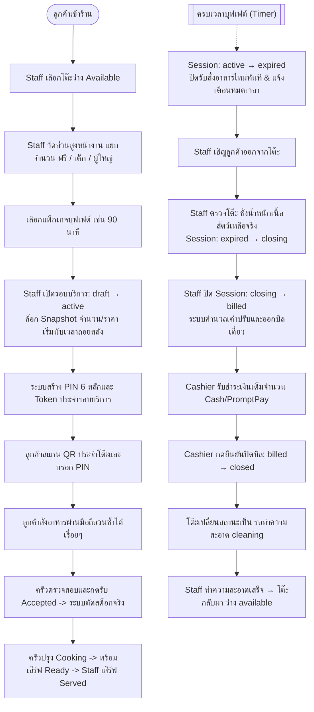

# 🥩 KURO POS

> **ระบบบริหารจัดการร้านอาหารบุฟเฟต์ปิ้งย่าง (Buffet POS & Inventory Management System)**  
> ออกแบบมาเพื่อบริหารจัดการกระบวนการขายหน้าร้าน ห้องครัว และสต็อกวัตถุดิบอย่างมีประสิทธิภาพสูงสุด ครอบคลุมการทำงานตั้งแต่ลูกค้าเดินเข้าร้านจนกระทั่งชำระเงินและทำความสะอาดโต๊ะ

---

[](https://nextjs.org)
[](https://supabase.com)
[](https://tailwindcss.com)
[](#)

---

## 📚 เอกสารประกอบโครงการ (Project Documentation)

| เอกสาร | รายละเอียด | ลิงก์ |
| :--- | :--- | :--- |
| **SRS** | ข้อกำหนดความต้องการทางซอฟต์แวร์ฉบับสมบูรณ์ (v1.7) | [`docs/01-requirements/SRS.md`](docs/01-requirements/SRS.md) |
| **Data Dictionary** | พจนานุกรมข้อมูลและคำอธิบายฟิลด์ของ 28 ตาราง | [`docs/02-database/data_dictionary.md`](docs/02-database/data_dictionary.md) |
| **Audit Matrix** | ตารางเมทริกซ์การบันทึก Audit Logs และความปลอดภัย | [`docs/03-audit/audit_matrix.md`](docs/03-audit/audit_matrix.md) |
| **Agent Blueprint** | สถาปัตยกรรมและกฎเหล็กสำหรับ AI/Developer | [`agent.md`](agent.md) |
| **Database Schema** | สคริปต์ SQL Migration เริ่มต้น (Schema + RLS) | [`supabase/migrations/001_initial_schema.sql`](supabase/migrations/001_initial_schema.sql) |

---

## 🎯 ภาพรวมของระบบ (System Overview)

### 👥 ผู้ใช้งานและสิทธิ์การเข้าถึง (User Roles)

ระบบแบ่งผู้ใช้งานออกเป็น **5 บทบาทภายใน** และ **1 บทบาทภายนอก**:

| บทบาท | คำอธิบายและหน้าที่ความรับผิดชอบหลัก |
| :--- | :--- |
| 👑 **Admin** | **ผู้ดูแลระบบและบริหารธุรกิจทั้งหมด:** จัดการบัญชีผู้ใช้, กำหนดสิทธิ์, แพ็กเกจราคา, เมนูอาหาร, วัตถุดิบ, เรียกดูรายงานภาพรวม และ Emergency Override |
| 👔 **Manager** | **ผู้จัดการร้าน:** บริหารเมนูประจำวัน, อนุมัติส่วนลดพิเศษ, ตรวจนับสต็อกหลังปิดร้าน, อนุมัติการปรับปรุงยอดผลต่างสต็อก |
| 🛎️ **Staff** | **พนักงานหน้าร้าน:** ตรวจวัดส่วนสูงลูกค้าหน้างาน, เปิด/ย้ายรอบบริการ (Session), ช่วยรับออเดอร์, ชั่งน้ำหนักเนื้อสัตว์เหลือจริง |
| 🍳 **Kitchen** | **แผนกครัว:** ตรวจสอบออเดอร์เข้า, ปรุงอาหาร, เปลี่ยนสถานะอาหารตามขั้นตอน, ปฏิเสธออเดอร์กรณีของหมด |
| 💵 **Cashier** | **แคชเชียร์:** ออกใบแจ้งยอด (Bill), ตรวจสอบสลิป PromptPay, รับชำระเงินเต็มจำนวน, บันทึกการปิดบิล |
| 📱 **Customer** | **ลูกค้า:** สแกน QR Code ประจำโต๊ะ + กรอก PIN 6 หลัก เพื่อเข้าสั่งอาหารผ่าน Mobile Web App |

---

## 🔄 วงจรการทำงานหลักของระบบ (Core Service Workflow)



---

## ⚖️ หลักการและกฎเหล็กสำคัญทางธุรกิจ (Core Business Principles)

> [!IMPORTANT]
> กฎเกณฑ์เหล่านี้เป็นหัวใจสำคัญของระบบ ห้ามแก้ไขข้ามขั้นตอนหรือละเว้นการตรวจสอบ:

* 🔒 **Snapshot Immobility:** ล็อกจำนวนลูกค้าและราคาต่อหัวทันทีที่เปิดรอบบริการ (`draft` $\rightarrow$ `active`) ห้ามแก้ไขย้อนหลังโดยเด็ดขาด
* 🧾 **One Bill, Paid in Full:** 1 รอบบริการ มี 1 บิลเดี่ยว (`bills` 1:1 `sessions`) และชำระเต็มจำนวนครั้งเดียว (`payments` 1:1 `bills`) ไม่แบ่งจ่าย
* 🥩 **Leftover Penalty:** คิดค่าปรับเนื้อสัตว์เหลือ 100 บาท ต่อทุก 100 กรัม (ปัดเศษขึ้น) โดยชั่งเฉพาะเนื้อสัตว์ที่รับประทานได้จริง
* 📦 **Actual Consumption Stock:** ตัดสต็อกจริงเมื่อครัวกดรับออเดอร์ (`accepted`) เท่านั้น พร้อมระบบป้องกันตัดสต็อกซ้ำซ้อน (Idempotency)
* 🛑 **Menu Stock Control:** วัตถุดิบหมดระบบปิดเมนูอัตโนมัติ (`auto_off`) และเปิดกลับเมื่อของเข้า ส่วนเมนูที่ปิดด้วยมือ (`manual_off`) ต้องให้ผู้มีอำนาจเปิดด้วยมือเท่านั้น
* 🧽 **Table Sanitization Cycle:** เมื่อจบ Session หรือย้ายโต๊ะ สถานะต้องเป็น `cleaning` เสมอ และต้องให้พนักงานกดยืนยันทำความสะอาดเสร็จจึงจะกลับเป็น `available`

---

## 🗄️ โครงสร้างฐานข้อมูล (Database Structure - 28 Tables)

ฐานข้อมูลทำงานบน Supabase PostgreSQL มีสคริปต์ Migration ฉบับสมบูรณ์อยู่ที่ [`supabase/migrations/001_initial_schema.sql`](supabase/migrations/001_initial_schema.sql):

| หมวดหมู่ | ตารางข้อมูล (Tables) | หน้าที่และความสำคัญ |
| :--- | :--- | :--- |
| 🛡️ **Identity & Access** | `profiles`<br>`audit_logs`<br>`app_settings` | ข้อมูลพนักงานและสิทธิ์การใช้งาน<br>บันทึก Audit Trail ของธุรกรรมสำคัญทั้งหมด<br>การตั้งค่าและคอนฟิกระบบส่วนกลาง |
| 🪑 **Tables & Sessions** | `dining_tables`<br>`packages`<br>`sessions`<br>`session_tables`<br>`qr_access_tokens`<br>`qr_pin_attempts` | ข้อมูลโต๊ะอาหารภายในร้าน<br>แพ็กเกจบุฟเฟต์และระยะเวลาให้บริการ<br>รอบบริการ ข้อมูลลูกค้า และ Snapshots ราคา<br>การผูกโต๊ะและประวัติการย้ายโต๊ะ<br>Access Token สำหรับสั่งอาหารผ่านมือถือลูกค้า<br>ประวัติการกรอก PIN ป้องกันการสุ่มรหัส (Brute-force) |
| 📖 **Menu & Catalog** | `categories`<br>`menu_items`<br>`package_menu_items`<br>`menu_item_options`<br>`menu_ingredients` | หมวดหมู่อาหาร<br>รายการอาหารและสถานะความพร้อมจำหน่าย<br>รายการอาหารที่รวมอยู่ในแต่ละแพ็กเกจ<br>ตัวเลือกเพิ่มเติมของเมนู (เช่น ระดับความเผ็ด, ขนาด)<br>สูตรอาหาร (Bill of Materials - BOM) สำหรับคำนวณตัดสต็อก |
| 🍳 **Ordering & Kitchen** | `orders`<br>`order_items`<br>`order_item_options` | หัวเอกสารการสั่งอาหารในแต่ละรอบ<br>รายการอาหาร สถานะการปรุงในครัว และประวัติการยกเลิก<br>ตัวเลือกเสริมที่ลูกค้าเลือกในแต่ละจาน |
| 💰 **Billing & Payments** | `bills`<br>`bill_items`<br>`payments`<br>`payment_attempts`<br>`leftover_records` | บิลเดี่ยวประจำรอบบริการและส่วนลด<br>รายการแจกแจงในใบเสร็จรับเงิน<br>ประวัติการชำระเงินเต็มจำนวนที่สำเร็จ<br>ประวัติการตรวจสอบสลิป PromptPay<br>บันทึกน้ำหนักเนื้อสัตว์เหลือจริงและการคำนวณค่าปรับ |
| 📦 **Inventory & Analysis** | `ingredients`<br>`stock_movements`<br>`stock_counts`<br>`stock_count_items`<br>`usage_rates`<br>`head_usage_estimates` | รายการวัตถุดิบและยอดสต็อกคงเหลือปัจจุบัน<br>สมุดบัญชีความเคลื่อนไหวสต็อก (Stock Ledger)<br>รอบตรวจนับสต็อกประจำวันหลังปิดร้าน<br>รายการตรวจนับและผลต่างสต็อก<br>อัตราการบริโภควัตถุดิบเฉลี่ยต่อหัว<br>ประมาณการใช้วัตถุดิบเพื่อการวิเคราะห์และวางแผน |

---

## 🛠️ เทคโนโลยีที่ใช้ (Tech Stack)

* **Frontend Framework:** [Next.js](https://nextjs.org) (App Router, Server Actions)
* **Language:** JavaScript (ES2022+, JSDoc Type Hints)
* **Styling & UI Components:** [Tailwind CSS v4](https://tailwindcss.com), [Lucide React](https://lucide.dev)
* **Database & Auth:** [Supabase](https://supabase.com) (PostgreSQL, Supabase Auth, Row Level Security)
* **Realtime Communication:** Supabase Realtime Channels (Postgres Changes & Broadcast)

---

## 📁 โครงสร้างโฟลเดอร์ของโปรเจกต์ (Project Structure)

```text
KURO/
├── docs/                         # เอกสารระบบ (SRS, Data Dictionary, Audit Matrix)
│   ├── 01-requirements/
│   ├── 02-database/
│   └── 03-audit/
├── public/                       # Static Assets & Icons
├── src/
│   ├── app/                      # Next.js App Router (Pages, Layouts, API Routes)
│   ├── components/               # UI & Business Components
│   └── lib/                      # Utilities & Database Client
├── supabase/
│   └── migrations/               # SQL Migration Files
├── agent.md                      # Blueprint & Non-Negotiable Business Rules
├── package.json
└── README.md
```

---

## 🚀 การเริ่มต้นใช้งานสำหรับนักพัฒนา (Getting Started)

### 1. ติดตั้ง Dependencies

```bash
npm install
```

### 2. ตั้งค่าตัวแปรสภาพแวดล้อม (Environment Variables)

สร้างไฟล์ `.env.local` ในรูทของโปรเจกต์:

```env
NEXT_PUBLIC_SUPABASE_URL=your-supabase-project-url
NEXT_PUBLIC_SUPABASE_ANON_KEY=your-supabase-anon-key
```

### 3. เตรียมฐานข้อมูล (Database Migration)

นำไฟล์ [`supabase/migrations/001_initial_schema.sql`](supabase/migrations/001_initial_schema.sql) ไปรันใน **Supabase SQL Editor** หรือใช้ Supabase CLI:

```bash
npx supabase db push
```

### 4. สร้าง TypeScript Types (ถ้าต้องการ)

```bash
npx supabase gen types typescript --local > types/database.types.ts
```

### 5. รันเซิร์ฟเวอร์สำหรับการพัฒนา (Development Server)

```bash
npm run dev
```

เปิดบราวเซอร์ไปที่ [http://localhost:3000](http://localhost:3000) เพื่อเข้าใช้งานระบบ
