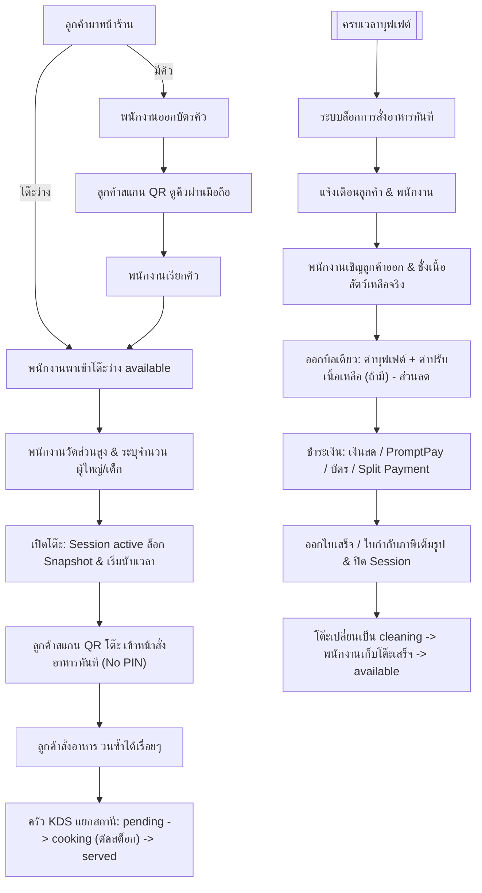
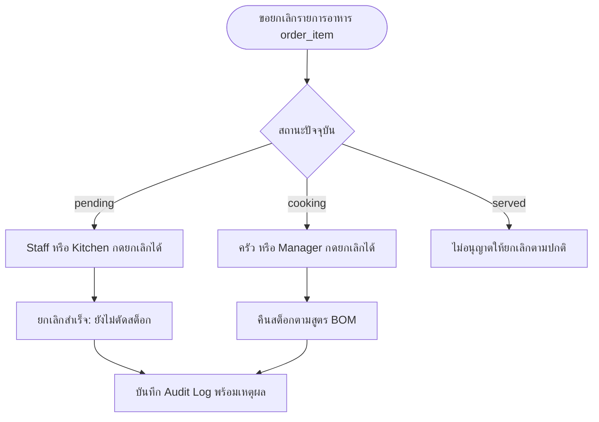
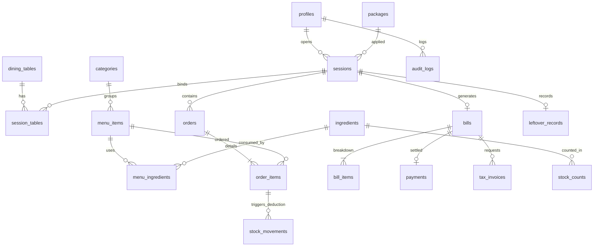

[README](../../README.md) • [SRS v1.8](SRS.md) • [Data Dictionary](../02-database/data_dictionary.md) • [Audit Matrix](../03-audit/audit_matrix.md) • [Agent Blueprint](../../AGENTS.md)

---

# KURO POS — Software Requirements Specification (SRS)
> **ระบบบริหารจัดการร้านอาหารบุฟเฟต์ชาบู (สุกี้ตี๋น้อย Model)**  
> **Version:** 1.8 | **Status:** Approved (Synchronized with UX/UI Spec) | **Date:** 12 พฤศจิกายน 2026

---

## สารบัญส่วนต่างๆ (Document Sections)
* [ส่วนที่ 1: ภาพรวมระบบและผู้ใช้งาน (System Overview & Actors)](#ส่วนที่-1--ภาพรวมระบบและผู้ใช้งาน)
* [ส่วนที่ 2: สถานะสากลของระบบ (Shared Global States)](#ส่วนที่-2--สถานะสากลของระบบ)
* [ส่วนที่ 3: ข้อกำหนดฟังก์ชัน (Functional Requirements: FR-001 ถึง FR-075)](#ส่วนที่-3--ข้อกำหนดฟังก์ชัน-functional-requirements)
* [ส่วนที่ 4: ข้อกำหนดที่ไม่ใช่ฟังก์ชัน (Non-Functional Requirements: NFR-001 ถึง NFR-024)](#ส่วนที่-4--ข้อกำหนดที่ไม่ใช่ฟังก์ชัน-non-functional-requirements)
* [ส่วนที่ 5: กฎทางธุรกิจและลำดับการทำงาน (Business Rules & Workflows)](#ส่วนที่-5--กฎทางธุรกิจและลำดับการทำงาน)
* [ส่วนที่ 6: ผังความสัมพันธ์ข้อมูล (ERD & 28 Tables)](#ส่วนที่-6--ผังความสัมพันธ์ข้อมูล-erd--tables)
* [ส่วนที่ 7: ขอบเขตที่ตัดออกในเฟสแรก (Phase 1 Out of Scope)](#ส่วนที่-7--ขอบเขตที่ตัดออกในเฟสแรก)

---

## ส่วนที่ 1 — ภาพรวมระบบและผู้ใช้งาน

### 1.1 วัตถุประสงค์และรูปแบบธุรกิจ
* **Business Model:** บุฟเฟต์ชาบู ราคาเดียวต่อหัว (Single Price per Head) ไม่มีราคาอาหารแยกรายจาน
* **การสั่งอาหาร:** ลูกค้าสแกน QR Code ประจำโต๊ะ สั่งอาหารผ่าน Mobile Web App โดย**ไม่ต้องลงทะเบียนและไม่ต้องกรอก PIN**
* **การดำเนินงาน:** พนักงานคุมคิวและผังโต๊ะผ่าน Tablet, ครัวแยกสถานีผ่าน KDS (Realtime), หลังบ้านบริหารผ่าน Desktop

### 1.2 ผู้ใช้งานและอุปกรณ์ (Actors & Devices)

| ผู้ใช้ (Role) | อุปกรณ์ | หน้าที่รับผิดชอบหลัก |
|---|---|---|
| **Customer (ลูกค้า)** | มือถือ (Mobile Web) | ดูคิว, สั่งอาหาร, ดูตัวจับเวลานับถอยหลัง, ดูสถานะอาหาร, เรียกพนักงาน, ดูสรุปออเดอร์ |
| **Staff (พนักงาน)** | แท็บเล็ต / มือถือ | ออกบัตรคิว, จัดการผังโต๊ะ (เปิด/ปิด/ย้าย/รวม/แยก), คิดเงิน, ชั่งเนื้อเหลือ, รับเรื่องแจ้งเตือน |
| **Kitchen (ครัว)** | จอใหญ่ / แท็บเล็ต (KDS) | หน้าจอ KDS แยก 4 สถานี, กดรับทำอาหาร (`cooking`) ตัดสต็อกจริง, กดเสิร์ฟ (`served`), Override ของหมด |
| **Cashier (แคชเชียร์)** | แท็บเล็ต / Desktop | สรุปบิล, ใส่ส่วนลด, รับเงิน (เงินสด/PromptPay/บัตร/Split Payment), ทอนเงิน, ออกใบเสร็จและใบกำกับภาษีเต็มรูป |
| **Manager (ผู้จัดการ)** | Desktop PC | จัดการเมนูประจำวัน, ตรวจนับสต็อกหลังปิดร้าน, อนุมัติปรับยอดสต็อก |
| **Admin (เจ้าของ/แอดมิน)** | Desktop PC | สิทธิ์สูงสุด: จัดการบัญชี/สิทธิ์, ตั้งค่าราคา/ระบบ, ดูรายงาน/Audit Log, Emergency Override |

---

## ส่วนที่ 2 — สถานะสากลของระบบ

> ดู [`agent.md`](../../agent.md) ส่วนที่ 3 (สถานะทั้ง 5 หมวดและเงื่อนไขการเปลี่ยน)
---

## ส่วนที่ 3 — ข้อกำหนดฟังก์ชัน (Functional Requirements)

### 3.1 บัญชีและสิทธิ์ (Identity & Access)
* **FR-001:** รองรับการเข้าสู่ระบบของพนักงานด้วย Email/Password หรือ Staff PIN (bcrypt)
* **FR-002:** กำหนดสิทธิ์ตามบทบาท 5 บทบาท: `admin`, `manager`, `staff`, `kitchen`, `cashier`
* **FR-003:** Admin จัดการเพิ่ม แก้ไข ปิดใช้งานบัญชีพนักงาน และกำหนดสิทธิ์รายหน้าจอ
* **FR-004:** ป้องกันการเข้าถึงข้อมูลข้ามบทบาทด้วย Supabase Row Level Security (RLS)

### 3.2 จัดการโต๊ะและรอบบริการ (Tables & Sessions - UX/UI 2.2)
* **FR-005:** รองรับโต๊ะอาหาร 20 โต๊ะ พร้อมหน้าจอผังโต๊ะแสดงสถานะด้วยสีและไอคอน
* **FR-006:** แสดงสถานะโต๊ะ 4 สถานะ: `available`, `occupied`, `cleaning`, `disabled`
* **FR-007:** พนักงานเปิดและปิดโต๊ะผ่าน Tablet หน้าร้าน
* **FR-008:** เมื่อเปิดโต๊ะ พนักงานระบุจำนวนผู้ใหญ่/เด็ก และเริ่มนับเวลาบุฟเฟต์ทันที
* **FR-009:** ระบบสร้าง Session และ QR Code ประจำโต๊ะ ลูกค้าสแกนเข้าสั่งได้ทันทีโดยไม่ต้องล็อกอิน/ไม่มี PIN
* **FR-010:** แสดงเวลานับถอยหลังของแต่ละโต๊ะบนผังโต๊ะแบบเรียลไทม์
* **FR-011:** รองรับการย้ายโต๊ะ (Transfer), การรวมโต๊ะ (Merge Tables), และการแยกโต๊ะ (Split Tables)

### 3.3 การเข้าถึงผ่าน QR Code ฝั่งลูกค้า (Customer QR Access - UX/UI 1.2)
* **FR-012:** แต่ละโต๊ะมี QR Code ผูกกับรอบบริการ (Session) ประจำโต๊ะ
* **FR-013:** ลูกค้าสแกน QR แล้วเข้าสู่หน้าสั่งอาหารและตัวจับเวลาได้ทันที (Zero-friction UX)
* **FR-014:** เมื่อปิดโต๊ะ (Session `closed`) QR Code ของรอบนั้นจะถูกเพิกถอนทันที (`is_revoked = true`); เมื่อหมดรอบบริการ (`expired`) ยังเปิดหน้าได้แต่สั่งอาหารไม่ได้
* **FR-015:** ระบบล็อกปุ่มสั่งอาหารบนหน้าจอมือถือของลูกค้าทันทีเมื่อครบเวลาบุฟเฟต์

### 3.4 เมนู ออเดอร์ และจอครัว KDS (Ordering & Kitchen - UX/UI 1.2, 3.1, 3.2)
* **FR-017:** จัดการรายการอาหาร หมวดหมู่ และกำหนดสถานีครัว (`fresh`, `beverage`, `grill`, `hot_kitchen`)
* **FR-018:** ลูกค้าเลือกดูเมนู ค้นหา ใส่ตะกร้า และสั่งอาหารด้วยตนเองผ่านมือถือ
* **FR-019:** พนักงานสามารถรับออเดอร์แทนลูกค้าผ่านแท็บเล็ตหน้าร้านได้
* **FR-020:** หน้าจอครัว (KDS) แยกตามสถานี การ์ดออเดอร์เรียงตามเวลา พร้อมสีเตือนเมื่อรอนาน
* **FR-021:** ครัวเปลี่ยนสถานะอาหาร 4 สถานะ: `pending` $\rightarrow$ `cooking` $\rightarrow$ `served` [หรือ `cancelled`]
* **FR-022:** **ระบบตัดสต็อกวัตถุดิบจริงตามสูตร (BOM) ทันทีเมื่อครัวกดปุ่ม `กำลังทำ (cooking)`**
* **FR-023:** หน้าจอ Override ให้ครัวและ Manager เปิด/ปิดขายเมนูด้วยตนเองทันที (`manual_off`)
* **FR-024:** เมื่อวัตถุดิบในสต็อกหมด ระบบปรับสถานะเมนูเป็น `out_of_stock` และแสดงสถานะ "หมด" บนหน้าลูกค้า (สั่งไม่ได้) อัตโนมัติ

### 3.5 ราคาบุฟเฟต์และ Snapshot (Buffet Pricing & Snapshot - UX/UI 4.3)
* **FR-025:** โมเดลราคาเดียวต่อหัว (Single Price Buffet) ไม่มีหน้าเลือกแพ็กเกจในเฟสแรก
* **FR-026:** กำหนดราคาผู้ใหญ่ และราคาเด็ก (เกณฑ์ส่วนสูง 120-139 ซม. เด็ก)
* **FR-027:** กำหนดระยะเวลาบุฟเฟต์เป็นนาที (`duration_minutes`) และคิดราคาตามเวลาจริง
* **FR-028:** กำหนดอัตรา VAT 7% (รวมในราคาแล้ว) และ Service Charge (ถ้ามี)
* **FR-029:** ล็อก Snapshot จำนวนลูกค้าและราคาต่อหัว ณ เวลาเปิดโต๊ะ (`active`) ห้ามแก้ไขย้อนหลัง

### 3.6 สต็อกวัตถุดิบและตรวจนับ (Inventory & Stock Count - UX/UI 4.4)
* **FR-030:** จัดการวัตถุดิบ บันทึกยอดคงเหลือ และกำหนดจุดสั่งซื้อขั้นต่ำ (Reorder Point)
* **FR-031:** กำหนดสูตรตัดสต็อก (BOM) ปริมาณวัตถุดิบที่ต้องใช้ต่อจาน
* **FR-032:** ตัดสต็อกอัตโนมัติ (Actual Consumption) เมื่อกด `cooking` ป้องกันการตัดซ้ำด้วย Unique Constraint
* **FR-033:** บันทึก Stock Movement Ledger ทุกความเคลื่อนไหว (ใช้จริง, รับเข้า, ของเสีย, ปรับยอด, คืนจากการยกเลิก)
* **FR-034:** แจ้งเตือนเมื่อสต็อกลดต่ำกว่า Reorder Point
* **FR-060:** Manager ตรวจนับสต็อกทุกวันหลังปิดร้าน บันทึกยอดในระบบและยอดตรวจนับจริง
* **FR-064:** เมื่อพบผลต่าง Manager ตรวจสอบเหตุผลและอนุมัติปรับยอดสต็อกพร้อมบันทึก Audit Trail

### 3.7 การชำระเงินและภาษี (Billing, Payments & Invoices - UX/UI 2.3, 2.4)
* **FR-039:** หน้าคิดเงินแสดงสรุป: ค่าบุฟเฟต์ผู้ใหญ่/เด็ก, ค่าบริการ, VAT 7% (Inclusive)
* **FR-040:** พนักงานเพิ่มรายการพิเศษได้ (เช่น ค่าปรับเนื้อสัตว์เหลือ, เครื่องดื่มนอกบุฟเฟต์)
* **FR-041:** พนักงานคิดเงิน (Cashier, Manager, Admin) กรอกส่วนลดได้พร้อมบันทึกเหตุผล
* **FR-042:** รองรับช่องทางชำระเงิน: **เงินสด, QR PromptPay, บัตรเครดิต, และการแบ่งจ่าย (Split Payment)**
* **FR-043:** ระบบคำนวณเงินทอนอัตโนมัติเมื่อรับเงินสด
* **FR-044:** แสดงตัวอย่างใบเสร็จก่อนพิมพ์ และปุ่มปิดบิล
* **FR-045:** รองรับการออก **ใบกำกับภาษีเต็มรูป** (ชื่อ นิติบุคคล/บุคคล, ที่อยู่, เลขผู้เสียภาษี 13 หลัก) พร้อมพิมพ์/อีเมล

### 3.8 การยกเลิกออเดอร์ (Order Cancellation - UX/UI 3.1)
* **FR-047:** สถานะ `pending`: Staff หรือ Kitchen ยกเลิกได้ (ยังไม่ตัดสต็อก ไม่ต้องคืน)
* **FR-048:** สถานะ `cooking`: ครัว หรือ Manager ยกเลิกได้ (คืนสต็อกตามสูตร BOM)
* **FR-049:** สถานะ `served`: ไม่อนุญาตให้ยกเลิกในโฟลว์ปกติ
* **FR-050:** ทุกการยกเลิกต้องระบุเหตุผลและบันทึกผู้ดำเนินการลงใน Audit Log

### 3.9 ค่าปรับอาหารเหลือและหมดเวลาบุฟเฟต์
* **FR-053:** เมื่อลูกค้าออกจากโต๊ะ Staff ตรวจโต๊ะและชั่งน้ำหนักเนื้อสัตว์เหลือจริงเข้าระบบ
* **FR-054:** คำนวณค่าปรับอัตรา 100 บาท ต่อทุก 100 กรัม (ปัดเศษขึ้น: `CEIL(weight / 100) * 100`)
* **FR-055:** รวมค่าปรับอาหารเหลือเข้าไปในบิลเดียวของรอบบริการ
* **FR-056:** แจ้งเตือนลูกค้าและพนักงานเมื่อครบเวลาบุฟเฟต์เท่านั้น (ไม่แจ้งเตือนล่วงหน้า)
* **FR-058:** ไม่มีค่าปรับเพิ่มจากการนั่งเกินเวลา (ไม่มีในเฟสแรก)
* **FR-062:** เมื่อครบเวลา ระบบปิดรับออเดอร์ใหม่ทันที (แต่ออเดอร์ที่สั่งเข้ามาก่อนครบเวลา ครัวปรุงและเสิร์ฟจนเสร็จ)

### 3.10 คิวหน้าร้านและเรียกพนักงาน (Queue & Service Requests - UX/UI 1.1, 1.4, 2.1, 2.5)
* **FR-066:** พนักงานออกบัตรคิวที่เคาน์เตอร์ ระบุจำนวนคน $\rightarrow$ ระบบเลือกขนาดโต๊ะเหมาะสม $\rightarrow$ พิมพ์บัตรคิวพร้อม QR
* **FR-067:** ลูกค้าสแกน QR บนบัตรคิวเพื่อดูเลขคิวตัวเอง คิวที่กำลังเรียก และจำนวนคิวที่เหลือผ่านมือถือ (ไม่มีจองคิวออนไลน์)
* **FR-068:** หน้าจอคิวพนักงานแสดงคิวเรียงลำดับ แยกตามขนาดโต๊ะ พร้อมปุ่ม: เรียกคิว, ข้าม, ยกเลิก, พิมพ์ซ้ำ
* **FR-069:** ลูกค้ามีปุ่มเรียกพนักงานบนมือถือ: *เรียกพนักงาน, ขอน้ำ, ขอเปลี่ยนเตา/หม้อ, ขอเช็คบิล, อื่นๆ* มีระบบกันกดซ้ำ
* **FR-070:** หน้าจอพนักงานแสดงการเรียกแบบ Realtime (ระบุโต๊ะ, ประเภทคำขอ, เวลารอ) พร้อมเสียงเตือนและปุ่มรับเรื่อง/เสร็จสิ้น

---

## ส่วนที่ 4 — ข้อกำหนดที่ไม่ใช่ฟังก์ชัน (Non-Functional Requirements)

* **NFR-001 (Cross-Platform):** ใช้งานผ่าน Web Browser ทั้ง Desktop, Tablet และ Mobile
* **NFR-002 (Security & Auth):** รหัสผ่านและ PIN พนักงานเข้ารหัสด้วย bcrypt; ไม่มีรหัสผ่านสำหรับลูกค้า
* **NFR-003 (Access Control):** ควบคุมสิทธิ์ระดับแถวด้วย Supabase RLS Policies ตาม Role
* **NFR-004 (Realtime):** สถานะโต๊ะ, คิว, ออเดอร์ KDS, และการเรียกพนักงาน ซิงค์ผ่าน Supabase Realtime ไม่ต้องรีเฟรช
* **NFR-005 (Audit Trail):** บันทึกประวัติการกระทำสำคัญ (ยกเลิกออเดอร์, ปรับยอดสต็อก, ให้ส่วนลด, ย้ายโต๊ะ, Override) ลง `audit_logs`
* **NFR-006 (Idempotency):** การตัดสต็อกและการชำระเงินมีระบบป้องกันการทำรายการซ้ำซ้อนในระดับฐานข้อมูล
* **NFR-007 (Financial Accuracy):** คำนวณ VAT 7% Inclusive ด้วยสูตร `ROUND(total * 7 / 107, 2)` ป้องกันปัญหาปัดเศษ
* **NFR-008 (UX Resilience):** หน้าจอมี Error Boundary, Offline Alert และ Empty State รองรับกรณีสัญญาณเน็ตขัดข้อง

---

## ส่วนที่ 5 — กฎทางธุรกิจและลำดับการทำงาน (Workflows)

### 5.1 System Lifecycle Workflow

### 5.2 Order & Kitchen Cancellation Workflow

---

## ส่วนที่ 6 — ผังความสัมพันธ์ข้อมูล (ERD & Tables)

ระบบทำงานบน **Supabase PostgreSQL ทั้งหมด 28 ตาราง** แบ่งเป็น 7 หมวด:

| หมวด | ตาราง (Tables) | รายละเอียด |
|---|---|---|
| **1. Identity** | `profiles`, `audit_logs`, `app_settings` | พนักงาน, บทบาท, ประวัติ Audit, การตั้งค่า |
| **2. Tables & Sessions** | `dining_tables`, `packages`, `sessions`, `session_tables`, `qr_access_tokens`, `qr_pin_attempts` | โต๊ะ 20 โต๊ะ, รอบบริการ, Snapshot ล็อก, QR Token |
| **3. Queue & Service** | `queues`, `service_requests` | คิวหน้าร้าน, คำขอเรียกพนักงานแบบเรียลไทม์ |
| **4. Menu & BOM** | `categories`, `menu_items`, `package_menu_items`, `menu_item_options`, `menu_ingredients` | หมวดหมู่, เมนู, สถานีครัว, สูตรตัดสต็อกต่อจาน |
| **5. Orders** | `orders`, `order_items`, `order_item_options` | ออเดอร์, รายการอาหาร 4 สถานะ, ออปชัน |
| **6. Billing & Tax** | `bills`, `bill_items`, `payments`, `payment_attempts`, `leftover_records`, `tax_invoices` | บิลเดี่ยว, การชำระเงิน, ค่าปรับเนื้อเหลือ, ใบกำกับภาษี |
| **7. Inventory** | `ingredients`, `stock_movements`, `stock_counts`, `stock_count_items`, `usage_rates`, `head_usage_estimates` | วัตถุดิบ, Ledger ตัดสต็อก, ตรวจนับสต็อกประจำวัน |

---

## ส่วนที่ 7 — ขอบเขตที่ตัดออกในเฟสแรก

> ดู [`agent.md`](../../agent.md) ส่วนที่ 7