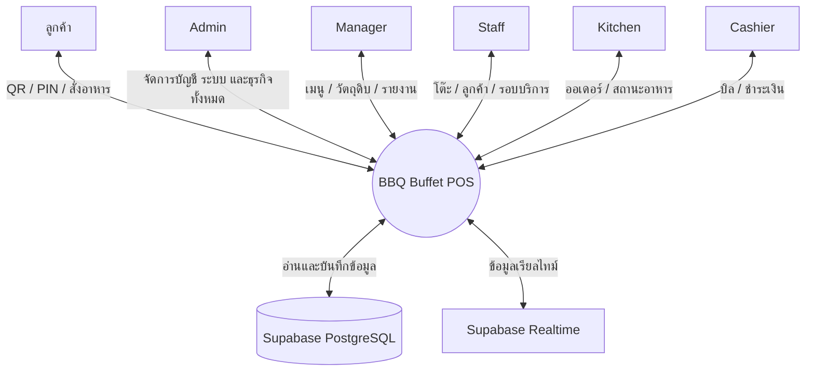
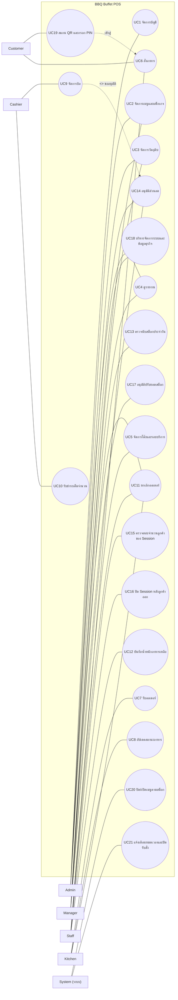
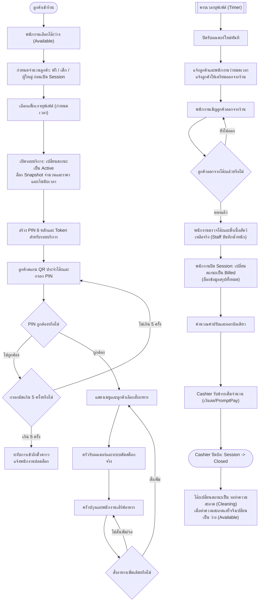
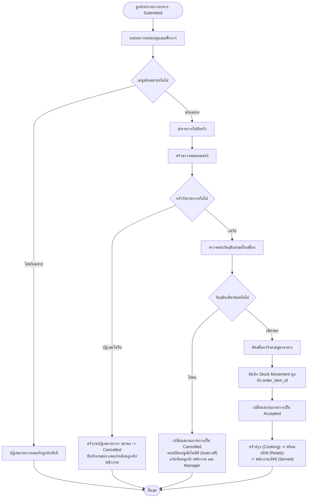
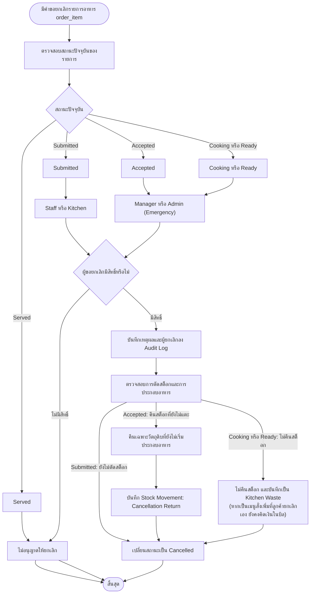
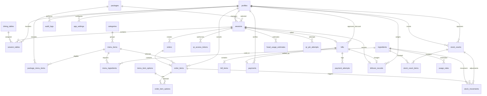
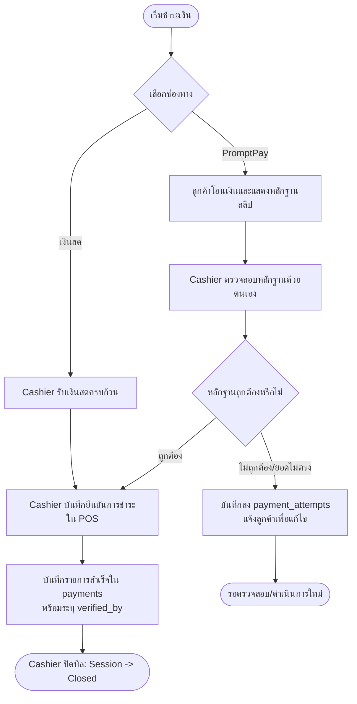
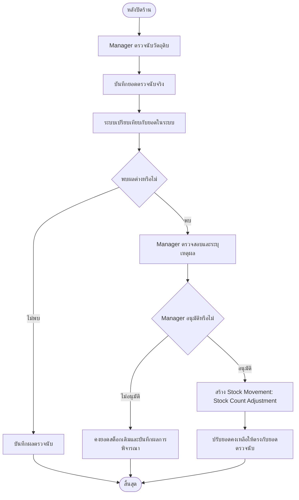
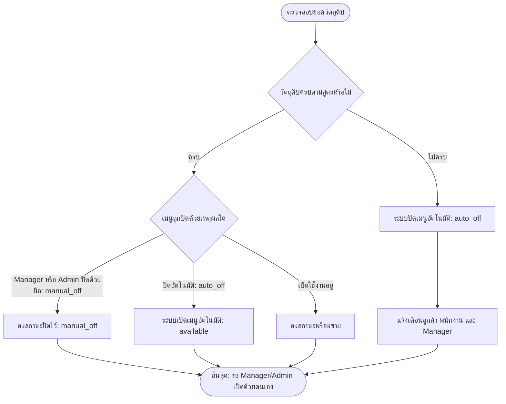

[🏠 หน้าหลัก (README)](../../README.md) • [📋 SRS (v1.7)](SRS.md) • [🗃️ Data Dictionary](../02-database/data_dictionary.md) • [🛡️ Audit Matrix](../03-audit/audit_matrix.md) • [🏗️ Agent Blueprint](../../agent.md) • [💾 Database Schema](../../supabase/migrations/001_initial_schema.sql)

---

# 📋 KURO POS - Software Requirements Specification (SRS)

| รายการ | รายละเอียด |
| :--- | :--- |
| **ประเภทเอกสาร** | Software Requirements Specification (SRS) |
| **เวอร์ชันอ้างอิง** | 1.7 -- Full Consistency & Schema-Ready |
| **วันที่ปรับปรุง** | 11 พฤศจิกายน 2026 |
| **สถานะ** | Pre-Final --- ผ่านการตรวจความสอดคล้อง A1-A8, B9-B16, C ครบถ้วน; รองรับการจัดทำ Database Schema |
| **จำนวนสมาชิก** | 3 คน |
| **จำนวนโต๊ะ** | 20 โต๊ะ |
| **Frontend** | Next.js, Tailwind CSS v4, JavaScript |
| **Backend** | Next.js API Routes / Server Actions |
| **Database** | Supabase PostgreSQL |
| **Authentication** | Supabase Auth |
| **Realtime** | Supabase Realtime |
| **Development** | Localhost |

> [!NOTE]
> **สถานะเอกสาร:** ฉบับนี้เป็น SRS v1.7 หลังปรับปรุงแก้ไขความสอดคล้องทุกมิติ (A1–A8, B9–B16 และข้อสังเกต C) จากผลการ Audit อย่างสมบูรณ์  
> เป็นเอกสารระดับ Pre-Final ที่พร้อม 100% สำหรับใช้เป็นฐานในการจัดทำ Physical Database Schema, Constraints, Triggers, RLS Policies และ Migration Script ต่อไป  
> ข้อกำหนดทั้งหมดได้รับการตรวจสอบความสอดคล้องระหว่าง Business Rules, Functional Requirements, Use Cases, Workflows และ ERD เรียบร้อยแล้ว

------------------------------------------------------------------------

# สารบัญ

1.  บทนำ
2.  ภาพรวมของระบบ
3.  ข้อกำหนดด้านฟังก์ชัน (Functional Requirements)
4.  ข้อกำหนดที่ไม่ใช่ฟังก์ชัน (Non-Functional Requirements)
5.  กฎทางธุรกิจ (Business Rules)
6.  Use Case
7.  System Workflow
8.  Order & Inventory Workflow
9.  Order Cancellation Workflow
10. Entity Relationship Diagram (ERD) และรายการตาราง
11. รายละเอียดการจัดการบิล
12. การจัดการวัตถุดิบและสต็อก
13. Input / Output
14. ขอบเขตที่ไม่รวมในโครงงาน
15. Requirement Traceability
16. Open Issues
17. สรุปการตัดสินใจและรายการที่ต้องแก้ไข

------------------------------------------------------------------------

# 1. บทนำ (Introduction)

## 1.1 ที่มาและความสำคัญ

ร้านอาหารบุฟเฟต์ปิ้งย่างมีการจัดการหลายส่วน ได้แก่ การจัดการโต๊ะและรับลูกค้า
การเลือกแพ็กเกจบุฟเฟต์ การสั่งอาหาร การจัดการรายการอาหารในครัว
การคิดเงินและชำระเงิน รวมถึงการควบคุมวัตถุดิบและสต็อก

หากใช้วิธีจดบันทึกด้วยตนเอง อาจเกิดข้อผิดพลาดในการรับออเดอร์ การคิดเงิน
และการตรวจสอบวัตถุดิบ จึงมีแนวคิดพัฒนาระบบ POS
เพื่อรวมการจัดการร้านอาหารไว้ในระบบเดียว โดยลูกค้าสามารถสแกน QR Code เพื่อสั่งอาหาร
พนักงานจัดการโต๊ะ ครัวจัดการออเดอร์ และผู้จัดการตรวจสอบวัตถุดิบและรายงานได้

## 1.2 วัตถุประสงค์

1.  พัฒนาระบบ POS สำหรับร้านบุฟเฟต์ปิ้งย่าง
2.  จัดการโต๊ะ ลูกค้า แพ็กเกจ และระยะเวลาบริการ
3.  ให้ลูกค้าสั่งอาหารผ่าน QR Code
4.  ให้ครัวจัดการสถานะรายการอาหาร
5.  จัดการข้อมูลวัตถุดิบและปริมาณคงเหลือ
6.  พัฒนาระบบตัดสต็อกตามสูตรอาหารและประมาณการใช้วัตถุดิบ
7.  จัดการการคิดเงินและการชำระเงินแบบหนึ่งบิลต่อหนึ่งรอบบริการ
8.  จัดทำรายงานสำหรับผู้จัดการและผู้ดูแลระบบ

## 1.3 ขอบเขตของโครงงาน

ระบบครอบคลุมงานต่อไปนี้

-   จัดการบัญชีและสิทธิ์ผู้ใช้งาน
-   จัดการโต๊ะอาหาร 20 โต๊ะ
-   จัดการแพ็กเกจบุฟเฟต์
-   จัดการหมวดหมู่และรายการอาหาร
-   สั่งอาหารผ่าน QR Code และพนักงาน
-   จัดการรายการอาหารในครัว
-   จัดการวัตถุดิบและสูตรอาหาร
-   ตัดสต็อกเมื่อครัวรับออเดอร์
-   ประเมินการใช้วัตถุดิบตามจำนวนลูกค้า
-   จัดการบิลเดียวต่อรอบบริการและการชำระเงินเต็มจำนวน
-   จัดทำรายงานและตรวจสอบประวัติการทำงาน
-   บันทึกน้ำหนักเนื้อสัตว์ที่เหลือและคำนวณค่าปรับตามเงื่อนไขร้าน
-   แจ้งเตือนลูกค้าและพนักงานเมื่อครบเวลาบุฟเฟต์

------------------------------------------------------------------------

# 2. ภาพรวมของระบบ (Overall Description)

## 2.1 ผู้ใช้งานระบบ

ระบบแบ่งผู้ใช้งานภายในเป็น 5 บทบาท และมีลูกค้าเป็นผู้ใช้งานภายนอก

  บทบาท      หน้าที่
  ---------- -------------------------------------
  Admin      จัดการระบบ บัญชี สิทธิ์ และการบริหารจัดการด้านธุรกิจทั้งหมด
  Manager    จัดการเมนู แพ็กเกจ วัตถุดิบ และรายงาน
  Staff      จัดการโต๊ะ เปิดรอบบริการ และช่วยรับออเดอร์
  Kitchen    ตรวจสอบออเดอร์และอัปเดตสถานะอาหาร
  Cashier    จัดการบิลและรับชำระเงิน
  Customer   สแกน QR Code และสั่งอาหาร

ลูกค้าไม่จำเป็นต้องสมัครสมาชิกหรือเข้าสู่ระบบด้วยบัญชีพนักงาน

### 2.1.1 หลักการกำหนดสิทธิ์ระหว่าง Admin และ Manager

- **Admin** เป็นผู้ดูแลระบบและมีสิทธิ์บริหารข้อมูลหลักด้านธุรกิจตาม FR-065 ได้แก่ บัญชีและสิทธิ์ ข้อมูลพนักงาน แพ็กเกจ/ราคา เมนู วัตถุดิบ รายงาน และการตรวจสอบประวัติการทำงาน ดังนั้น Admin สามารถดำเนินการจัดการข้อมูลหลักที่ระบุว่า Manager ทำได้ด้วย
- **Manager** รับผิดชอบงานบริหารร้านประจำวันและทำงานตาม Use Case ที่กำหนดให้ Manager โดยเฉพาะ
- สิทธิ์ที่ระบุผู้รับผิดชอบเฉพาะไว้ชัดเจนยังคงเป็นข้อยกเว้น ไม่ขยายสิทธิ์โดยอนุมานจากคำว่า Admin เช่น การตรวจนับและอนุมัติปรับยอดสต็อกตาม OI-016 ยังคงเป็นหน้าที่ Manager เท่านั้น
- การยกเลิกออเดอร์ยังเป็นไปตามสถานะและผู้มีสิทธิ์ที่ระบุใน FR-047 ถึง FR-052; การเป็น Admin ไม่ทำให้ข้ามขั้นตอนหรือแก้ไขประวัติธุรกรรมโดยตรงได้
- Admin และ Manager อนุมัติส่วนลดได้ตาม FR-040/BR-029; ผู้อนุมัติและเหตุผลต้องถูกบันทึก

| ความสามารถ | Admin | Manager | หมายเหตุ |
|---|---|---|---|
| บัญชีผู้ใช้ / Role / Permission / ตั้งค่าระบบ | ได้ | ไม่ได้ | Admin เท่านั้น |
| จัดการข้อมูลพนักงาน | ได้ | ตามสิทธิ์ที่กำหนด | Admin ดูแลสิทธิ์หลัก |
| จัดการเมนู / แพ็กเกจ / ราคา / วัตถุดิบ | ได้ | ได้ | Admin มีสิทธิ์บริหารข้อมูลหลัก; Manager ทำงานประจำวัน (รวมถึงเปิด/ปิดเมนูด้วยมือ) |
| ดูรายงาน / Audit History | ได้ | ได้ตามสิทธิ์ | Admin ตรวจสอบภาพรวมได้ |
| อนุมัติส่วนลด | ได้ | ได้ | ต้องบันทึก Audit Trail |
| ตรวจนับและอนุมัติปรับยอดสต็อกประจำวัน | Override ได้เฉพาะฉุกเฉิน | ได้ | ปกติเป็น Manager-only; หากจำเป็นเร่งด่วน Admin ทำแทนได้โดยบันทึก Audit Trail ชัดเจน |
| ยกเลิกออเดอร์ Accepted ถึง Ready | Override ได้เฉพาะฉุกเฉิน | ได้ | ปกติเป็น Manager-only; หากจำเป็นเร่งด่วน Admin ทำแทนได้โดยบันทึก Audit Trail ชัดเจน |
| แก้ไข/ลบธุรกรรมย้อนหลังโดยตรง | ไม่ได้ | ไม่ได้ | ใช้กระบวนการปรับปรุง/ยกเลิกที่ระบบรองรับ |

> ตารางนี้อธิบายขอบเขตสิทธิ์ตามข้อกำหนดที่ยืนยันแล้ว โดยใช้เป็นเกณฑ์หลักในการออกแบบ Supabase RLS Policies และ API Authorization ในขั้นตอน Database Design

## 2.2 เทคโนโลยีที่ใช้

| เทคโนโลยี | วัตถุประสงค์ |
| :--- | :--- |
| **Next.js** (App Router) | พัฒนาเว็บแอปพลิเคชันฝั่ง Frontend และ Backend |
| **JavaScript** (ES2022+, JSDoc) | ภาษาหลักสำหรับการพัฒนา |
| **Tailwind CSS v4** | ออกแบบส่วนติดต่อผู้ใช้ |
| **Next.js Server Actions / API Routes** | ประมวลผลฝั่งเซิร์ฟเวอร์ |
| **Supabase** | Backend-as-a-Service และบริการฐานข้อมูล |
| **PostgreSQL** | จัดเก็บข้อมูลเชิงสัมพันธ์ |
| **Supabase Auth** | ยืนยันตัวตนพนักงาน (Email/Password) |
| **Supabase Realtime** | อัปเดตข้อมูลแบบเรียลไทม์ (Broadcast & Postgres Changes) |
| **Row Level Security (RLS)** | ควบคุมสิทธิ์การเข้าถึงข้อมูลระดับแถว |
| **Figma** | ออกแบบ UI/UX |
| **Mermaid / Graphviz** | ออกแบบและสร้าง Diagram |
| **Git / GitHub** | จัดการ Source Code |

## 2.3 ภาพรวมการทำงาน

1.  ลูกค้าเข้าร้าน พนักงานต้อนรับ
2.  พนักงานเลือกโต๊ะว่าง (สถานะ `available`)
3.  พนักงานวัดส่วนสูงลูกค้าที่หน้างานเพื่อจัดประเภทตามเกณฑ์ (ต่ำกว่า 120 ซม. ฟรี / 120 ถึงต่ำกว่า 140 ซม. เด็ก / ตั้งแต่ 140 ซม. ผู้ใหญ่) และนับจำนวนแยกประเภท โดยไม่บันทึกส่วนสูงรายบุคคลในระบบ
4.  เลือกแพ็กเกจบุฟเฟต์ (กำหนดระยะเวลา เช่น 90 นาที)
5.  พนักงานเปิดรอบบริการ (`draft` -> `active`) ระบบล็อก Snapshot จำนวนลูกค้าและราคาต่อหัว ณ เวลานั้น และเริ่มนับเวลาถอยหลัง
6.  ระบบสร้าง PIN 6 หลักและ Token สำหรับรอบนั้น พนักงานแจ้ง PIN ให้ลูกค้า
7.  ลูกค้าสแกน QR Code ประจำโต๊ะและกรอก PIN (หากกรอกผิดเกิน 5 ครั้ง ระบบจะระงับการเข้าถึงชั่วคราวและต้องให้พนักงานปลดล็อก)
8.  ลูกค้าเลือกและสั่งอาหารผ่านเว็บแอปพลิเคชัน
9.  ออเดอร์ส่งไปยังครัว (สถานะ `Submitted`)
10. ครัวตรวจสอบออเดอร์และกดรับรายการ (หากวัตถุดิบไม่พอหรือเหตุสุดวิสัย ครัวสามารถปฏิเสธรายการเพื่อเปลี่ยนเป็น `Cancelled` พร้อมแจ้งลูกค้าและพนักงาน)
11. เมื่อครัวกดรับ ระบบตรวจสอบวัตถุดิบและตัดสต็อกจริง (Actual Consumption) พร้อมเปลี่ยนสถานะเป็น `Accepted`
12. ครัวปรุง (`Cooking`) และส่งสัญญาณพร้อมเสิร์ฟ (`Ready`) พนักงานนำไปเสิร์ฟ (`Served`)
13. ลูกค้าสามารถสั่งอาหารเพิ่มเติมได้เรื่อยๆ แบบวนซ้ำจนกว่าจะครบเวลาบุฟเฟต์
14. เมื่อครบเวลา ระบบปิดรับออเดอร์ใหม่ทันทีและแจ้งเตือนทั้งลูกค้าและพนักงาน (ออเดอร์ที่สั่งเข้ามาก่อนครบเวลายังคงปรุงและเสิร์ฟจนเสร็จ)
15. พนักงานเชิญลูกค้าออกจากร้าน เมื่อลูกค้าออกจากโต๊ะแล้ว พนักงานตรวจโต๊ะและชั่งน้ำหนักเนื้อสัตว์ที่เหลือจริง (ถ้ามี) แล้วบันทึกน้ำหนักเข้าระบบ
16. พนักงานปิด Session (`closing` -> `billed`) ระบบคำนวณค่าปรับอาหารเหลือ (ถ้ามี) รวมกับค่าบุฟเฟต์และอาหารสั่งเพิ่ม และออกบิลเดี่ยวของรอบบริการ
17. ลูกค้าชำระเงินเต็มจำนวนในครั้งเดียวผ่าน Cashier (เงินสด หรือ PromptPay ตรวจสอบสลิปด้วยตนเอง) เมื่อชำระสำเร็จ Cashier กดยืนยันเพื่อปิดบิล (`closed`)
18. โต๊ะถูกปรับสถานะเป็น "รอทำความสะอาด" (`cleaning`) เมื่อพนักงานทำความสะอาดเรียบร้อย จึงปรับเป็น "ว่าง" (`available`) พร้อมเปิดรับรอบบริการใหม่ ป้องกันการเปิดรอบใหม่ทับโต๊ะที่ยังไม่ชำระเงิน

## 2.4 System Context Diagram

------------------------------------------------------------------------

# 3. ข้อกำหนดด้านฟังก์ชัน (Functional Requirements)

## 3.1 ระบบบัญชีและสิทธิ์ผู้ใช้งาน

  ID       ข้อกำหนด
  -------- --------------------------------------
  FR-001   รองรับการเข้าสู่ระบบของพนักงาน
  FR-002   กำหนดสิทธิ์ตามบทบาท
  FR-003   Admin เพิ่ม แก้ไข และปิดใช้งานบัญชีพนักงานได้
  FR-004   ป้องกันผู้ไม่มีสิทธิ์เข้าถึงข้อมูล

## 3.2 ระบบจัดการโต๊ะ

  ID       ข้อกำหนด
  -------- -----------------------------------------------------
  FR-005   รองรับโต๊ะ 20 โต๊ะ
  FR-006   แสดงสถานะโต๊ะ 3 สถานะ ได้แก่ ว่าง (`available`), มีลูกค้า (`occupied`), และรอทำความสะอาด (`cleaning`)
  FR-007   พนักงานเปิดและปิดรอบบริการได้
  FR-008   ให้พนักงานตรวจวัดส่วนสูงลูกค้าที่หน้างานและบันทึกเฉพาะจำนวนรวมแยกประเภทฟรี เด็ก และผู้ใหญ่ก่อนเปิด Session โดยไม่จัดเก็บส่วนสูงรายบุคคลในระบบ จากนั้นใช้จำนวนดังกล่าวเป็น Snapshot ประจำ Session พร้อมเก็บราคาต่อหัวของแพ็กเกจแต่ละประเภท ณ เวลาเปิด Session
  FR-009   กำหนดแพ็กเกจให้ลูกค้า
  FR-010   แสดงเวลาการใช้บริการและเวลาคงเหลือ โดยเริ่มนับเวลาทันทีเมื่อเปิด Session (`sessions.started_at`) ตามระยะเวลาของแพ็กเกจ (`duration_minutes`)
  FR-011   Staff สามารถย้ายรอบบริการไปยังโต๊ะว่างได้ โดยคงรอบบริการ ออเดอร์ เวลา และบิลเดิม และไม่รวมรอบบริการ

## 3.3 ระบบ QR Code

  ID       ข้อกำหนด
  -------- -------------------------------
  FR-012   แต่ละโต๊ะมี QR Code ประจำโต๊ะ
  FR-013   แต่ละรอบบริการมี PIN 6 หลัก
  FR-014   ตรวจสอบ PIN ก่อนเข้าสู่หน้าสั่งอาหาร
  FR-015   QR Token ใช้ได้ตลอดรอบบริการและหมดอายุทันทีเมื่อปิดรอบบริการ
  FR-016   จำกัดจำนวนครั้งในการกรอก PIN ผิด (ไม่เกิน 5 ครั้ง) หากเกินจะล็อกการเข้าถึงชั่วคราวและต้องให้พนักงานปลดล็อกหรือสร้าง PIN ใหม่

## 3.4 ระบบจัดการเมนูและออเดอร์

  ID       ข้อกำหนด
  -------- ------------------------------------------
  FR-017   Manager หรือ Admin เพิ่ม แก้ไข และปิดใช้งานรายการอาหารด้วยตนเองได้ โดยสถานะปิดด้วยมือต้องแยกจากสถานะที่ระบบปิดเพราะวัตถุดิบไม่เพียงพอ
  FR-018   แบ่งหมวดหมู่อาหาร
  FR-019   ลูกค้าสั่งอาหารผ่าน QR Code ได้
  FR-020   พนักงานรับรายการอาหารแทนลูกค้าได้
  FR-021   ตรวจสอบสิทธิ์แพ็กเกจก่อนรับรายการอาหาร
  FR-022   เมนูที่ไม่รวมในแพ็กเกจต้องคิดราคาเพิ่ม
  FR-023   แสดงสถานะรายการอาหารแบบเรียลไทม์
  FR-024   ครัวรับและอัปเดตสถานะออเดอร์ได้ รวมถึงปฏิเสธรับออเดอร์สถานะ Submitted ได้กรณีวัตถุดิบหมดกะทันหันหรือเหตุสุดวิสัย โดยระบบเปลี่ยนสถานะเป็น Cancelled และแจ้งเตือนลูกค้ากับพนักงานทันที

สถานะออเดอร์ (บริหารจัดการที่ระดับ `order_items`):

  สถานะ       ความหมาย
  ----------- ------------------
  Submitted   ส่งรายการอาหารแล้ว
  Accepted    ครัวรับรายการแล้ว (ระบบตัดสต็อกจริง)
  Cooking     กำลังปรุงอาหาร
  Ready       อาหารพร้อมเสิร์ฟ
  Served      เสิร์ฟอาหารแล้ว
  Cancelled   ยกเลิกรายการ

## 3.5 ระบบแพ็กเกจบุฟเฟต์

  ID       ข้อกำหนด
  -------- ---------------------------------
  FR-025   Manager หรือ Admin เพิ่มและแก้ไขแพ็กเกจได้ รวมถึงกำหนดระยะเวลาการให้บริการบุฟเฟต์เป็นนาที (`duration_minutes`)
  FR-026   รองรับราคาแยกผู้ใหญ่ เด็ก และลูกค้าประเภทฟรี
  FR-027   กำหนดรายการอาหารที่รวมในแพ็กเกจได้
  FR-028   กำหนดราคาเพิ่มเติมสำหรับเมนูที่ไม่รวมได้
  FR-029   คำนวณราคาจากจำนวน/ประเภทลูกค้าและราคาต่อหัวของแพ็กเกจที่บันทึกเป็น Snapshot ณ เวลาเปิด Session โดยคงยอดค่าบุฟเฟต์เดิมตลอด Session แม้มีการแก้ไขราคาแพ็กเกจในภายหลัง

เกณฑ์ที่พนักงานใช้ในการจำแนกประเภทลูกค้าที่หน้างานเพื่อบันทึกจำนวนแยกประเภทเข้าสู่ระบบ: ต่ำกว่า 120 ซม. ฟรี, 120 ถึงต่ำกว่า 140 ซม. เป็นเด็ก และตั้งแต่ 140 ซม. เป็นผู้ใหญ่ โดยระบบไม่บันทึกส่วนสูงรายบุคคล

## 3.6 ระบบจัดการวัตถุดิบ

  ID       ข้อกำหนด
  -------- ---------------------------------------
  FR-030   Manager หรือ Admin จัดการข้อมูลวัตถุดิบได้
  FR-031   บันทึกปริมาณวัตถุดิบคงเหลือ
  FR-032   กำหนดสูตรการใช้วัตถุดิบต่อเมนู
  FR-033   ตัดสต็อกเมื่อครัวกดรับออเดอร์
  FR-034   บันทึกประวัติการเคลื่อนไหวของสต็อก
  FR-035   ประเมินการใช้วัตถุดิบจากจำนวนลูกค้าและแพ็กเกจ
  FR-036   เปรียบเทียบปริมาณการใช้จริงกับประมาณการ
  FR-037   ปิดการขายเมนูอัตโนมัติเมื่อวัตถุดิบไม่เพียงพอ และเปิดกลับอัตโนมัติเฉพาะเมนูที่ระบบปิดด้วยเหตุผลนี้เมื่อวัตถุดิบเพียงพอแล้ว
  FR-038   ตรวจสอบวัตถุดิบอีกครั้งก่อนรับออเดอร์เข้าครัว

> การตรวจนับสต็อกประจำวันกำหนดเป็น FR-060 ในหัวข้อ 3.10 เพื่อแยกจากการตัดสต็อกตามออเดอร์

### หลักการตัดสต็อก

-   **Actual Consumption:** ตัดสต็อกจริงจากสูตรอาหารและจำนวนรายการที่ครัวรับ
-   **Estimated Consumption:** ประมาณการใช้วัตถุดิบจากจำนวนลูกค้าและแพ็กเกจ
    ใช้เพื่อวิเคราะห์เท่านั้น
-   ห้ามนำ Estimated Consumption ไปตัดสต็อกจริงซ้ำ

ตัวอย่าง: หมูสไลซ์ 1 จานใช้หมู 100 กรัม ลูกค้าสั่ง 3 จาน เมื่อครัวรับออเดอร์ ระบบตัดสต็อก
300 กรัม

หากวัตถุดิบอย่างน้อยหนึ่งรายการในสูตรอาหารไม่เพียงพอ ระบบต้องปิดเมนูนั้นโดยอัตโนมัติและบันทึกแหล่งที่มาของการปิดเป็นการปิดอัตโนมัติ พร้อมแจ้งสถานะให้ลูกค้าและพนักงานทราบ เมื่อมีการรับวัตถุดิบเข้าสต็อกหรือยอดคงเหลือเปลี่ยนแปลง ระบบตรวจสอบสูตรอีกครั้ง และเปิดเมนูอัตโนมัติเฉพาะเมนูที่ระบบเคยปิดเนื่องจากวัตถุดิบไม่เพียงพอและวัตถุดิบทุกตัวเพียงพอแล้วเท่านั้น เมนูที่ Manager ปิดใช้งานด้วยตนเองต้องคงสถานะปิดไว้ แม้วัตถุดิบจะเพียงพอแล้วก็ตาม

## 3.7 ระบบบิลและชำระเงิน

ข้อกำหนดเดิมจาก SRS 0.3 มีรายการแบ่งบิลและชำระเงินหลายครั้ง
แต่ถูกปรับตามการยืนยันล่าสุดดังนี้

  ID       ข้อกำหนดปัจจุบัน
  -------- ------------------------------------
  FR-039   คำนวณราคาแพ็กเกจและอาหารเพิ่มเติม
  FR-040   รองรับส่วนลดโดย Manager/Admin เท่านั้น พร้อมบันทึกผู้อนุมัติ จำนวนหรือเปอร์เซ็นต์ เหตุผล และเวลา
  FR-041   รองรับ VAT 7% แบบรวมอยู่ในราคา โดยคำนวณภาษีถอดในด้วยสูตร `VAT = ยอดรวมสุทธิ × 7 ÷ 107` และปัดเศษทศนิยม 2 ตำแหน่งแบบ Half-up
  FR-042   หนึ่งรอบบริการมีบิลเดียว
  FR-043   รองรับการชำระเงิน 2 ช่องทาง ได้แก่ เงินสดและ PromptPay โดย Cashier ตรวจสอบหลักฐานการโอนด้วยตนเองก่อนยืนยันการชำระเงินในระบบ และมีระบบบันทึกความพยายามชำระเงิน (`payment_attempts`) หากสลิปไม่ถูกต้องหรือไม่ผ่านการตรวจสอบ
  FR-044   ลูกค้าต้องชำระยอดเต็มจำนวนในครั้งเดียว
  FR-045   แสดงยอดที่ต้องชำระ
  FR-046   แสดงใบเสร็จบนหน้าจอ

กฎปัจจุบัน:

1.  คิดค่าบุฟเฟต์ตามจำนวนลูกค้าแยกประเภทฟรี เด็ก และผู้ใหญ่
2.  รวมค่าอาหารเพิ่มเติมทั้งหมดในบิลของโต๊ะ
3.  รวมค่าปรับอาหารเหลือ (ถ้ามี) ในบิลเดียวกัน
4.  ไม่มีการแบ่งบิล
5.  ไม่มีการแยกจ่ายรายคน
6.  ต้องชำระยอดรวมทั้งหมดในครั้งเดียว
7.  เมื่อครบเวลาบุฟเฟต์ พนักงานเชิญลูกค้าออกจากร้าน ตรวจสอบและบันทึกน้ำหนักเนื้อสัตว์ที่เหลือ (ถ้ามี) บันทึกเข้าระบบ จากนั้นปิด Session เพื่อล็อกข้อมูลทั้งหมด แล้วจึงออกบิล; Cashier รับชำระเงินเต็มจำนวนและปิดบิล; เมื่อปิดบิลแล้ว สถานะโต๊ะเปลี่ยนเป็นรอทำความสะอาด (`cleaning`)

ช่องทางชำระเงินที่ยืนยันแล้วมี 2 ช่องทาง ได้แก่

- **เงินสด:** Cashier รับเงินสดจากลูกค้าและบันทึกยืนยันการชำระเงินในระบบ
- **PromptPay:** ลูกค้าโอนเงินผ่าน PromptPay และแสดงหลักฐานการโอนให้ Cashier ตรวจสอบ Cashier ตรวจสอบหลักฐานด้วยตนเองก่อนกดยืนยันการชำระเงินในระบบ หากไม่ถูกต้อง ให้บันทึกลงในประวัติความพยายามชำระเงิน (`payment_attempts`)

ระบบไม่ตรวจสอบการโอนเงินโดยอัตโนมัติ และไม่มีการเชื่อมต่อ Payment Gateway หรือ API ของผู้ให้บริการชำระเงิน

## 3.8 ระบบยกเลิกออเดอร์

การยกเลิกออเดอร์บริหารจัดการที่ระดับรายการอาหาร (`order_items`):

  ID       ข้อกำหนด
  -------- ---------------------------------------------------------
  FR-047   Staff ยกเลิกรายการสถานะ Submitted ได้ และครัวสามารถปฏิเสธรับรายการ Submitted ได้กรณีวัตถุดิบหมดหรือเหตุสุดวิสัย โดยเปลี่ยนสถานะเป็น Cancelled
  FR-048   Manager (หรือ Admin กรณีฉุกเฉินที่มี Audit Trail) ยกเลิกรายการสถานะ Accepted, Cooking และ Ready ได้
  FR-049   ไม่คืนสต็อกอัตโนมัติเมื่อรายการอยู่ในสถานะ Cooking หรือ Ready โดยบันทึกเป็นของเสีย (Waste); หากเป็นเมนูสั่งเพิ่มที่ลูกค้ายกเลิกเองหลังเริ่มปรุงแล้ว ร้านยังคงคิดเงินในบิล
  FR-050   บันทึกเหตุผลและผู้ยกเลิก
  FR-051   ป้องกันการคืนสต็อกซ้ำ โดยอ้างอิงรหัส `order_items`
  FR-052   ไม่อนุญาตให้ยกเลิกรายการสถานะ Served ผ่านกระบวนการปกติ

  ----------------------------------------------------------------------------------
  สถานะ                   ผู้มีสิทธิ์                   การคืนสต็อก
  ----------------------- ----------------------- ----------------------------------
  Submitted               Staff หรือ Kitchen       ไม่ต้องคืน (ยังไม่ตัดสต็อก)

  Accepted                Manager (หรือ Admin)    คืนเฉพาะส่วนที่ยังไม่เริ่มประกอบอาหาร

  Cooking                 Manager (หรือ Admin)    ไม่คืนสต็อก (บันทึกเป็น Kitchen Waste)

  Ready                   Manager (หรือ Admin)    ไม่คืนสต็อก (บันทึกเป็น Kitchen Waste)

  Served                  ไม่อนุญาตให้ยกเลิกตามปกติ ไม่มีคืน
  ----------------------------------------------------------------------------------

ทุกครั้งต้องบันทึกผู้ยกเลิก เหตุผล วันเวลา และการคืนวัตถุดิบ

## 3.9 ระบบหมดเวลาบุฟเฟต์และอาหารเหลือ

ข้อกำหนดต่อไปนี้เป็นข้อมูลที่ผู้ใช้ยืนยันเพิ่มเติมภายหลัง SRS 0.3

  ID       ข้อกำหนด
  -------- --------------------------------------------------------------------------------------------------------------------------------
  FR-053   ระบบต้องรองรับให้พนักงาน (Staff) บันทึกน้ำหนักเนื้อสัตว์ที่เหลือจริง (ตาม OI-015)
  FR-054   ระบบต้องคำนวณค่าปรับในอัตรา 100 บาทต่อทุก 100 กรัม และปัดน้ำหนักขึ้นเป็นหน่วย 100 กรัม
  FR-055   ระบบต้องนำค่าปรับอาหารเหลือไปรวมในบิลเดียวของรอบบริการ
  FR-056   ระบบต้องแจ้งเตือนลูกค้าเมื่อครบเวลาบุฟเฟต์เท่านั้น
  FR-057   ระบบต้องแจ้งเตือนพนักงานเมื่อครบเวลาบุฟเฟต์เท่านั้น
  FR-058   ระบบต้องไม่คิดค่าบริการเพิ่มจากการใช้เวลาเกินกำหนด
  FR-059   ระบบต้องบันทึก Snapshot จำนวนลูกค้าแยกประเภทฟรี เด็ก และผู้ใหญ่ รวมถึงราคาต่อหัวของแพ็กเกจแต่ละประเภท ณ เวลาเปิด Session และห้ามเปลี่ยนแปลงหลังเปิด Session
  FR-061   ระบบต้องปฏิเสธการเพิ่ม ลด หรือแก้ไขจำนวน/ประเภทลูกค้าใน Session ที่เปิดใช้งานแล้ว; การแก้ไขทำได้ก่อนเปิด Session เท่านั้น
  FR-062   เมื่อครบเวลาบุฟเฟต์ ระบบต้องปิดรับออเดอร์ใหม่ทันที และปฏิเสธคำสั่งสั่งอาหารใหม่ของรอบบริการนั้น
  FR-063   ระบบต้องแจ้งลูกค้าให้เตรียมออกจากร้านและแจ้งพนักงานให้เชิญลูกค้าออก เมื่อลูกค้าออกจากโต๊ะแล้ว พนักงานตรวจและชั่งน้ำหนักเนื้อสัตว์ที่เหลือจริงเข้าระบบ จากนั้นจึงปิด Session และดำเนินการออกบิล

> **หมายเหตุ FR-053:** ผู้มีสิทธิ์ดำเนินการชั่งและบันทึกน้ำหนักเนื้อสัตว์ที่เหลือคือ Staff ตาม OI-015

ข้อกำหนดการล็อกจำนวนลูกค้าและราคา:

- ก่อนเปิด Session พนักงานต้องกำหนดจำนวนลูกค้าแยกประเภทฟรี เด็ก และผู้ใหญ่ให้ถูกต้อง
- ขณะเปิด Session ระบบต้องบันทึก Snapshot จำนวนลูกค้า ประเภทลูกค้า และราคาต่อหัวของแพ็กเกจแต่ละประเภทลงในข้อมูล Session
- หลังเปิด Session แล้ว ผู้ใช้งานทุกบทบาทรวมถึง Manager ไม่มีสิทธิ์เพิ่ม ลด หรือแก้ไขจำนวน/ประเภทลูกค้า หรือแก้ไข Snapshot ราคาต่อหัวของ Session นั้น
- หากพบว่าจำนวนลูกค้าก่อนเปิด Session ไม่ถูกต้อง ต้องแก้ไขก่อนเปิด Session เท่านั้น; เมื่อเปิดแล้วห้ามแก้ไขย้อนหลัง
- ราคาบุฟเฟต์รวมของ Session คำนวณจากจำนวนและราคาต่อหัวตาม Snapshot และไม่เปลี่ยนตามจำนวนลูกค้าที่ออกจากร้านก่อนเวลา หรือการแก้ไขราคาแพ็กเกจในภายหลัง

> หมายเลข FR ในฉบับนี้มี FR-001 ถึง FR-065 โดย FR-059 และ FR-061 กำหนดการบันทึก Snapshot และการล็อกจำนวนลูกค้าตลอด Session, FR-060 และ FR-064 รองรับการตรวจนับและอนุมัติปรับยอดสต็อก, FR-062–FR-063 รองรับขั้นตอนหมดเวลาและปิด Session ตาม OI-014 และ FR-065 รองรับสิทธิ์การบริหารจัดการของ Admin

### เงื่อนไขค่าปรับอาหารเหลือ

-   คิดค่าปรับ 100 บาทต่อทุก 100 กรัม
-   หากน้ำหนักไม่ครบ 100 กรัม ให้ปัดขึ้นเป็นหน่วย 100 กรัมถัดไป
-   คำนวณค่าปรับด้วยสูตร: `CEILING(น้ำหนักเนื้อที่เหลือเป็นกรัม / 100) × 100` บาท
-   ชั่งเฉพาะเนื้อสัตว์ที่รับประทานได้และเหลือจริง
-   ไม่รวมกระดูก
-   ไม่รวมเปลือกกุ้ง
-   ไม่รวมเปลือกหอย
-   ไม่รวมเศษที่ไม่ใช่เนื้อสัตว์
-   บันทึกน้ำหนักจริงและค่าปรับที่คำนวณได้
-   นำค่าปรับไปรวมในบิลเดียวของโต๊ะ

ตัวอย่าง:

    น้ำหนักเนื้อที่เหลือ     ค่าปรับ
  --------------- ---------
          100 กรัม   100 บาท
          101 กรัม   200 บาท
          150 กรัม   200 บาท
          200 กรัม   200 บาท
          250 กรัม   300 บาท
          300 กรัม   300 บาท
          500 กรัม   500 บาท

หมายเหตุ: น้ำหนักที่มากกว่า 0 กรัม แม้เพียงเล็กน้อย จะถูกปัดขึ้นตามหน่วย 100 กรัม ส่วนกรณีไม่มีเนื้อสัตว์เหลือ (0 กรัม) จะไม่มีค่าปรับ

### เงื่อนไขเมื่อครบเวลาบุฟเฟต์ (OI-014: ยืนยันแล้ว)

-   เมื่อครบเวลาบุฟเฟต์ ระบบต้องปิดรับออเดอร์ใหม่ทันที
-   ระบบแจ้งเตือนลูกค้าและพนักงานว่าหมดเวลาแล้ว โดยแจ้งเมื่อครบเวลาเท่านั้น ไม่แจ้งเตือนล่วงหน้า 30 นาทีหรือ 15 นาที
-   ระบบแจ้งลูกค้าให้เตรียมตัวออกจากร้าน
-   พนักงานเป็นผู้ดำเนินการเชิญลูกค้าออกจากร้าน
-   เมื่อลูกค้าออกจากร้านเรียบร้อยแล้ว พนักงานจึงปิด Session และระบบจึงดำเนินการออกบิลตามยอดที่ต้องชำระ
-   ไม่มีค่าปรับหรือค่าบริการเพิ่มเติมจากการใช้เวลาเกินกำหนด
-   การครบเวลาเพียงอย่างเดียวไม่ทำให้ Session ถูกปิดอัตโนมัติ; ต้องรอพนักงานยืนยันว่าลูกค้าออกจากร้านแล้ว

## 3.10 ระบบตรวจนับสต็อกประจำวัน

  ID       ข้อกำหนด
  -------- ----------------------------------------------------------------------------------------------------------------------------------
  FR-060   ระบบต้องรองรับการตรวจนับสต็อกทุกวันหลังปิดร้าน โดย Manager เป็นผู้รับผิดชอบ บันทึกยอดในระบบและยอดที่ตรวจนับได้จริง พร้อมผลต่าง
  FR-064   เมื่อพบผลต่างของสต็อก ระบบต้องให้ Manager ตรวจสอบเหตุผลและอนุมัติการปรับยอดก่อนบันทึก Stock Movement เพื่อปรับยอดคงเหลือ พร้อมเก็บผู้อนุมัติ วันเวลา เหตุผล ยอดก่อนปรับ ยอดที่ตรวจนับได้ และจำนวนผลต่างเพื่อการตรวจสอบย้อนหลัง

ข้อกำหนดการปรับยอด:

-   Manager เป็นผู้ตรวจนับ ตรวจสอบผลต่าง และอนุมัติการปรับยอดสต็อก
-   ระบบต้องคำนวณผลต่างระหว่างยอดคงเหลือในระบบกับยอดที่ตรวจนับได้จริง
-   ต้องระบุเหตุผลประกอบการปรับยอดทุกครั้ง
-   ห้ามปรับยอดคงเหลือจริงจากผลตรวจนับโดยอัตโนมัติก่อน Manager อนุมัติ
-   เมื่อ Manager อนุมัติแล้ว ระบบจึงบันทึก Stock Movement ประเภท Stock Count Adjustment เพื่อปรับยอดคงเหลือให้ตรงกับยอดตรวจนับ
-   ต้องบันทึกผู้ตรวจนับ ผู้อนุมัติ วันเวลา ยอดก่อนปรับ ยอดตรวจนับ ผลต่าง และเหตุผลในประวัติที่ตรวจสอบย้อนหลังได้
-   ผู้อนุมัติต้องเป็น Manager; บทบาทอื่นไม่มีสิทธิ์อนุมัติการปรับยอดตามข้อกำหนดนี้ (ยกเว้นกรณีฉุกเฉินเร่งด่วนที่ Manager ไม่อยู่ Admin สามารถอนุมัติแทนได้โดยระบบต้องบันทึก Audit Trail ระบุชัดเจนว่าเป็น Emergency Override พร้อมเหตุผล)

------------------------------------------------------------------------

## 3.11 สิทธิ์การบริหารจัดการของ Admin

**FR-065:** ระบบต้องกำหนดให้ Admin เป็นบทบาทผู้ดูแลระบบและผู้มีอำนาจบริหารจัดการข้อมูลและการดำเนินงานด้านธุรกิจทั้งหมด ได้แก่ บัญชีผู้ใช้และสิทธิ์การเข้าถึง ข้อมูลพนักงาน แพ็กเกจและราคา เมนู วัตถุดิบ รายงาน และการดูประวัติการทำงาน รวมถึงอนุมัติส่วนลดตาม FR-040 และสิทธิ์ Emergency Override ในกรณีจำเป็นเร่งด่วน โดยไม่สามารถแก้ไขหรือลบประวัติธุรกรรมที่เกิดขึ้นแล้วโดยตรง

ขอบเขตสิทธิ์ของ Admin:
- จัดการบัญชีผู้ใช้ การกำหนด Role/Permission และการตั้งค่าระบบ
- ดูแลข้อมูลพนักงาน แพ็กเกจและราคา เมนู วัตถุดิบ รายงาน และตรวจสอบประวัติการทำงาน
- อนุมัติส่วนลดตามเงื่อนไขที่กำหนดร่วมกับ Manager
- ดำเนินการแทน Manager ในกรณีฉุกเฉินเร่งด่วน (Emergency Override) สำหรับการยกเลิกออเดอร์และการอนุมัติสต็อก โดยมี Audit Trail กำกับ
- การแก้ไขธุรกรรมที่บันทึกแล้วต้องใช้กระบวนการปรับปรุงหรือยกเลิกที่ระบบกำหนด ห้ามแก้ไขหรือลบข้อมูลเดิมโดยตรง และต้องมี Audit Trail

**BR-036:** Admin มีสิทธิ์บริหารจัดการระบบและด้านธุรกิจทั้งหมดตามขอบเขตข้างต้น รวมถึงดูประวัติธุรกรรม แต่ไม่มีสิทธิ์แก้ไขหรือลบประวัติธุรกรรมเดิมโดยตรง; การแก้ไขที่จำเป็นต้องดำเนินการผ่านรายการปรับปรุง/ยกเลิกที่ระบบรองรับและมี Audit Trail

# 4. ข้อกำหนดที่ไม่ใช่ฟังก์ชัน (Non-Functional Requirements)

  ID        ข้อกำหนด
  --------- -----------------------------------------------
  NFR-001   ใช้งานผ่าน Web Browser ได้
  NFR-002   รองรับ Desktop, Tablet และ Mobile
  NFR-003   ตรวจสอบสิทธิ์ก่อนเข้าถึงข้อมูล
  NFR-004   ใช้ RLS ควบคุมการเข้าถึงฐานข้อมูล
  NFR-005   จัดเก็บรหัสผ่านผ่านระบบ Authentication ที่ปลอดภัย
  NFR-006   จัดเก็บ PIN ในรูปแบบ Hash
  NFR-007   จัดเก็บ Token ในรูปแบบ Hash
  NFR-008   ยกเลิก Token เมื่อปิดรอบบริการ
  NFR-009   ป้องกันการส่งคำสั่งซ้ำ
  NFR-010   ป้องกันการตัดสต็อกซ้ำ โดยอ้างอิงรหัส `order_items` กับ `stock_movements`
  NFR-011   รองรับการอัปเดตสถานะแบบเรียลไทม์
  NFR-012   บันทึกประวัติการทำงานที่สำคัญ
  NFR-013   ป้องกันการชำระเงินเกินยอดที่ต้องชำระ
  NFR-014   รักษาความถูกต้องของยอดเงิน
  NFR-015   รักษาความถูกต้องของปริมาณวัตถุดิบ
  NFR-016   ตรวจสอบข้อมูลก่อนบันทึก
  NFR-017   ใช้ Transaction กับกระบวนการที่มีผลต่อสต็อกและยอดเงิน
  NFR-018   รองรับการพัฒนาต่อยอด
  NFR-019   มีโครงสร้างโค้ดที่ดูแลรักษาได้
  NFR-020   ตรวจสอบข้อผิดพลาดย้อนหลังได้
  NFR-021   ป้องกันการเข้าถึงข้อมูลลูกค้าโดยไม่ได้รับอนุญาต
  NFR-022   การกำหนดจำนวนลูกค้าก่อนเปิด Session การย้ายโต๊ะ การตรวจนับสต็อก การให้ส่วนลด การยกเลิกออเดอร์ และการชั่งอาหารเหลือต้องมี Audit Trail บันทึกผู้กระทำ (`profile_id`) ย้อนหลังได้

------------------------------------------------------------------------

# 5. กฎทางธุรกิจ (Business Rules)

  ID       กฎทางธุรกิจ
  -------- ------------------------------------------------------
  BR-001   ระบบมีโต๊ะทั้งหมด 20 โต๊ะ
  BR-002   แต่ละโต๊ะมี QR Code ประจำโต๊ะ
  BR-003   แต่ละรอบบริการมี PIN 6 หลัก
  BR-004   เกณฑ์ที่พนักงานใช้จัดประเภทลูกค้าที่หน้างาน: ต่ำกว่า 120 ซม. ฟรี, 120 ถึงต่ำกว่า 140 ซม. เด็ก, ตั้งแต่ 140 ซม. ขึ้นไป ผู้ใหญ่ โดยระบบเก็บเฉพาะจำนวนแยกประเภท ไม่เก็บส่วนสูงรายบุคคล
  BR-005   ระบบคำนวณราคาบุฟเฟต์จากจำนวนลูกค้าแยกประเภทที่พนักงานบันทึกตามเกณฑ์ BR-004 คูณด้วยราคาต่อหัวตาม Snapshot ของแพ็กเกจ
  BR-006   ลูกค้าสั่งอาหารโดยไม่ต้องสมัครสมาชิกได้
  BR-007   รายการอาหารต้องเป็นไปตามเงื่อนไขแพ็กเกจ
  BR-008   เมนูที่ไม่รวมในแพ็กเกจมีค่าใช้จ่ายเพิ่มเติม
  BR-009   ตรวจสอบวัตถุดิบก่อนรับออเดอร์
  BR-010   ระบบปิดเมนูอัตโนมัติเมื่อวัตถุดิบอย่างน้อยหนึ่งรายการในสูตรไม่เพียงพอ และเปิดกลับอัตโนมัติเฉพาะเมนูที่ระบบปิดด้วยเหตุนี้เมื่อวัตถุดิบทุกตัวเพียงพอ; เมนูที่ Manager หรือ Admin ปิดด้วยตนเองต้องไม่ถูกเปิดกลับอัตโนมัติ
  BR-011   ตัดสต็อกเมื่อครัวกด Accepted
  BR-012   ประมาณการวัตถุดิบแยกจากสต็อกจริง
  BR-013   การยกเลิกออเดอร์ต้องบันทึกประวัติ
  BR-014   Staff ยกเลิกได้เฉพาะ Submitted และครัวปฏิเสธรับ Submitted ได้กรณีวัตถุดิบหมดหรือเหตุสุดวิสัย
  BR-015   Manager (หรือ Admin กรณีฉุกเฉิน) ยกเลิกได้ตั้งแต่ Accepted ถึง Ready
  BR-016   Cooking หรือ Ready ไม่คืนสต็อกอัตโนมัติ โดยบันทึกเป็น Kitchen Waste; เมนูสั่งเพิ่มที่ลูกค้ายกเลิกเองยังคงคิดเงินในบิล
  BR-017   Served ไม่สามารถยกเลิกผ่านกระบวนการปกติ
  BR-018   ราคาที่แสดงรวม VAT 7% แล้ว (คำนวณถอดในด้วยสูตร `ยอดรวมสุทธิ × 7 ÷ 107` ปัดเศษ 2 ตำแหน่งแบบ Half-up)
  BR-019   หนึ่งรอบบริการมีบิลเดียว
  BR-020   ลูกค้าต้องชำระยอดเต็มจำนวนครั้งเดียว
  BR-021   การใช้เวลาเกินแพ็กเกจไม่คิดค่าบริการเพิ่ม
  BR-022   แจ้งเตือนลูกค้าและพนักงานเมื่อครบเวลาเท่านั้น
  BR-023   ค่าปรับอาหารเหลือคิด 100 บาทต่อทุก 100 กรัม โดยน้ำหนักที่ไม่ครบ 100 กรัมให้ปัดขึ้นเป็นหน่วย 100 กรัมถัดไป
  BR-024   ชั่งเฉพาะเนื้อสัตว์ที่รับประทานได้และเหลือจริง
  BR-025   ไม่รวมกระดูก เปลือกกุ้ง เปลือกหอย และเศษที่ไม่ใช่เนื้อสัตว์ในการชั่ง
  BR-026   ค่าปรับอาหารเหลือรวมอยู่ในบิลเดียวของโต๊ะ
  BR-027   จำนวนลูกค้าแยกประเภทฟรี เด็ก และผู้ใหญ่ต้องถูกกำหนดก่อนเปิด Session และห้ามเพิ่มหรือลดจำนวนลูกค้าตลอด Session
  BR-028   ตรวจนับสต็อกทุกวันหลังปิดร้าน โดยผู้จัดการร้านเป็นผู้รับผิดชอบ
  BR-029   Admin และ Manager มีสิทธิ์อนุมัติส่วนลด; พนักงานบทบาทอื่นไม่มีสิทธิ์
  BR-030   QR Token ของรอบบริการต้องหมดอายุทันทีเมื่อรอบบริการถูกปิด
  BR-031   ราคาบุฟเฟต์คำนวณจากจำนวน/ประเภทลูกค้าและราคาต่อหัวแพ็กเกจตาม Snapshot ณ เวลาเปิด Session และคงเดิมจน Session สิ้นสุด; ห้ามเพิ่ม/ลดจำนวนลูกค้าหรือเปลี่ยน Snapshot หลังเปิด Session
  BR-032   เมื่อครบเวลาบุฟเฟต์ ระบบต้องปิดรับออเดอร์ใหม่ทันที และแจ้งลูกค้า/พนักงานเมื่อครบเวลาเท่านั้น
  BR-033   พนักงานต้องเชิญลูกค้าออกจากร้าน ตรวจสอบและชั่งน้ำหนักเนื้อสัตว์เหลือจริง (ถ้ามี) บันทึกเข้าระบบ แล้วจึงปิด Session ก่อนดำเนินการออกบิล โดยไม่คิดค่าบริการเพิ่มจากการเกินเวลา; เมื่อบิลถูกชำระเรียบร้อย สถานะโต๊ะเปลี่ยนเป็นรอทำความสะอาด (`cleaning`)
  BR-034   การปรับยอดสต็อกจากผลตรวจนับต้องได้รับอนุมัติจาก Manager ก่อน (หรือ Admin กรณีฉุกเฉิน) และต้องบันทึกเหตุผล ผู้ตรวจนับ ผู้อนุมัติ ยอดก่อนปรับ ยอดตรวจนับ ผลต่าง และ Stock Movement
  BR-035   พนักงานต้องตรวจวัดส่วนสูงลูกค้าที่หน้างานเพื่อจัดประเภทตามเกณฑ์ แต่ระบบจัดเก็บเฉพาะจำนวนลูกค้าแยกประเภท ไม่จัดเก็บส่วนสูงรายบุคคล
  BR-036   Admin มีสิทธิ์บริหารจัดการระบบและด้านธุรกิจทั้งหมด รวมถึงดูประวัติธุรกรรม แต่ไม่มีสิทธิ์แก้ไขหรือลบประวัติธุรกรรมเดิมโดยตรง; การแก้ไขที่จำเป็นต้องผ่านรายการปรับปรุง/ยกเลิกที่ระบบรองรับและมี Audit Trail
  BR-037   Session Lifecycle ประกอบด้วยสถานะ draft, active, expired, closing, billed, และ closed โดยระบบล็อก Snapshot และเริ่มนับเวลาเมื่อเปลี่ยนเป็น active
  BR-038   โต๊ะมี 3 สถานะ ได้แก่ ว่าง (`available`), มีลูกค้า (`occupied`), และ รอทำความสะอาด (`cleaning`); โต๊ะจะกลับมาว่างเมื่อพนักงานทำความสะอาดเสร็จเท่านั้น
  BR-039   ข้อยกเว้นฉุกเฉิน (Emergency Override): Admin สามารถอนุมัติปรับยอดสต็อกหรือยกเลิกออเดอร์แทน Manager ได้กรณีจำเป็นเร่งด่วน โดยมี Audit Trail กำกับทุกครั้ง

ข้อกำหนดเพิ่มเติม: การที่ลูกค้าบางคนออกจากร้านก่อน Session สิ้นสุด ไม่ทำให้จำนวนลูกค้าตาม Snapshot ลดลง และไม่ทำให้ระบบคืนหรือลดค่าบุฟเฟต์; การแก้ไขราคาแพ็กเกจใน Master Data ภายหลังเปิด Session ไม่เปลี่ยนราคาของ Session ที่เปิดอยู่

------------------------------------------------------------------------

# 6. Use Case

## 6.1 รายการ Use Case

  รหัส    Use Case                   ผู้ใช้งาน
  ------ -------------------------- ----------------------------------
  UC1    จัดการบัญชีและสิทธิ์             Admin
  UC2    จัดการเมนูและแพ็กเกจ          Manager / Admin
  UC3    จัดการวัตถุดิบ                 Manager / Admin
  UC4    ดูรายงาน                    Manager / Admin
  UC5    จัดการโต๊ะ ย้ายโต๊ะ และรอบบริการ Staff
  UC6    สั่งอาหาร                    Customer / Staff
  UC7    รับออเดอร์                   Kitchen
  UC8    อัปเดตสถานะอาหาร            Kitchen
  UC9    จัดการบิล                    Cashier
  UC10   รับชำระเงินเต็มจำนวนและปิดบิล   Cashier
  UC11   ยกเลิกออเดอร์                Staff / Kitchen / Manager (Admin Override)
  UC12   บันทึกน้ำหนักเนื้อสัตว์เหลือ        Staff
  UC13   ตรวจนับสต็อกประจำวัน              Manager (Admin Override)
  UC14   อนุมัติส่วนลด                     Manager / Admin
  UC15   ตรวจสอบจำนวนลูกค้าของรอบบริการ    Staff
  UC16   ปิด Session หลังลูกค้าออกจากร้าน      Staff
  UC17   ตรวจสอบและอนุมัติปรับยอดสต็อก       Manager (Admin Override)
  UC18   บริหารจัดการระบบและข้อมูลธุรกิจทั้งหมด Admin
  UC19   เข้าถึงเมนูสั่งอาหารด้วย QR และ PIN Customer
  UC20   ตรวจสอบและเปิด/ปิดเมนูอัตโนมัติ   System
  UC21   แจ้งเตือนหมดเวลาและระงับการสั่งอาหารใหม่ System

## 6.2 Use Case Diagram

> **OI-015 ยืนยันแล้ว:** พนักงาน (Staff) เป็นผู้รับผิดชอบชั่งและบันทึกน้ำหนักเนื้อสัตว์ที่เหลือใน UC12
>
> **OI-016 ยืนยันแล้ว:** Manager เป็นผู้ตรวจนับ ตรวจสอบผลต่าง และอนุมัติการปรับยอดสต็อกใน UC13/UC17 ก่อนระบบบันทึก Stock Movement; Admin สามารถ Override ได้เฉพาะกรณีฉุกเฉินเร่งด่วน

------------------------------------------------------------------------

# 7. System Workflow

 > Workflow แสดงลำดับที่ยืนยันแล้ว: จำนวนลูกค้าและราคาต่อหัวแพ็กเกจถูกกำหนดและล็อกเมื่อเปิด Session ไม่มีการเพิ่ม/ลดจำนวนหรือแก้ Snapshot ระหว่างรอบ; เมื่อครบเวลาปิดรับออเดอร์ทันที แจ้งลูกค้าและพนักงาน ให้ลูกค้าเตรียมออก พนักงานเชิญออก และปิด Session หลังลูกค้าออกจากร้านแล้ว จากนั้นจึงบันทึกอาหารเหลือและออกบิล โดยไม่มีค่าบริการเพิ่มจากการเกินเวลา

------------------------------------------------------------------------

# 8. Order & Inventory Workflow

หลักการ:

-   การตรวจสอบวัตถุดิบและตัดสต็อกต้องป้องกันการทำงานซ้ำ (Idempotency)
-   ป้องกันการรับออเดอร์พร้อมกันจนสต็อกติดลบ โดยใช้ Database Transaction และ Row Locking
-   ป้องกันการตัดสต็อกซ้ำด้วยการผูก `order_item_id` เข้ากับ `stock_movements`
-   Estimated Consumption ใช้เพื่อวิเคราะห์ ไม่ตัดสต็อกจริง

------------------------------------------------------------------------

# 9. Order Cancellation Workflow

------------------------------------------------------------------------

# 10. Entity Relationship Diagram (ERD) และรายการตาราง

## 10.1 รายชื่อตารางฐานข้อมูล

ต้นฉบับ SRS 0.3 ระบุ 26 ตาราง; v0.5 เพิ่ม `leftover_records` เป็นตารางที่ 27 เพื่อรองรับข้อกำหนดน้ำหนักและค่าปรับ; v1.7 เพิ่ม `payment_attempts` เป็นตารางที่ 28 เพื่อรองรับประวัติการตรวจสอบสลิปของ Cashier โดยรายการด้านล่างแสดงครบทั้ง 28 ตาราง

    ลำดับ ตาราง                    วัตถุประสงค์
  ------ ------------------------ ------------------------------
       1 `profiles`               ข้อมูลพนักงานและบทบาท
       2 `dining_tables`          ข้อมูลโต๊ะ
       3 `packages`               ข้อมูลแพ็กเกจ
       4 `sessions`               รอบการใช้บริการ
       5 `session_tables`         ความสัมพันธ์รอบบริการกับโต๊ะ
       6 `categories`             หมวดหมู่อาหาร
       7 `menu_items`             รายการอาหาร
       8 `package_menu_items`     เมนูที่รวมในแพ็กเกจ
       9 `menu_item_options`      ตัวเลือกเพิ่มเติมของเมนู
      10 `menu_ingredients`       สูตรวัตถุดิบต่อเมนู
      11 `orders`                 ข้อมูลออเดอร์
      12 `order_items`            รายการอาหารในออเดอร์
      13 `order_item_options`     ตัวเลือกของรายการอาหาร
      14 `qr_access_tokens`       Token เข้าถึงหน้าสั่งอาหาร
      15 `bills`                  ข้อมูลบิล
      16 `bill_items`             รายการภายในบิล
      17 `payments`               ข้อมูลการชำระเงิน
      18 `ingredients`            ข้อมูลวัตถุดิบ
      19 `usage_rates`            อัตราการใช้วัตถุดิบโดยประมาณ
      20 `stock_movements`        ประวัติการเคลื่อนไหวสต็อก
      21 `stock_counts`           รอบการตรวจนับสต็อก
      22 `stock_count_items`      รายการตรวจนับสต็อก
      23 `audit_logs`             ประวัติการทำงานในระบบ
      24 `app_settings`           การตั้งค่าระบบ
      25 `qr_pin_attempts`        ประวัติการกรอก PIN
      26 `head_usage_estimates`   ประมาณการใช้วัตถุดิบตามจำนวนลูกค้า
      27 `leftover_records`       น้ำหนักเนื้อสัตว์เหลือจริงและค่าปรับของรอบบริการ
      28 `payment_attempts`      ประวัติความพยายามชำระเงินที่ไม่สำเร็จ (เชื่อมกับ `bills`)

## 10.2 ER Diagram ภาพรวม

> ERD นี้เป็นภาพแนวคิดของทั้ง 28 ตาราง (รวม `app_settings` ที่เก็บค่าคอนฟิกระบบ และ `payment_attempts` ที่เพิ่มใน v1.7):
> - `sessions` มีบิลได้ไม่เกินหนึ่งใบ (`1:1`) และ `bills` มีรายการชำระเงินสำเร็จได้ไม่เกินหนึ่งรายการ (`1:1`) โดยชำระยอดเต็มจำนวนตาม BR-020
> - ประวัติการตรวจสอบหรือความพยายามชำระเงินที่ไม่สำเร็จจัดเก็บใน `payment_attempts` (เชื่อมกับ `bills`) เพื่อไม่ให้กระทบ Unique Constraint ของ `payments`
> - `order_items` เชื่อมโยงกับ `stock_movements` โดยตรงเพื่อป้องกันการตัดสต็อกซ้ำและการคืนสต็อกซ้ำ (NFR-010, FR-051)
> - `leftover_records` มีความสัมพันธ์แบบ `1:1` กับ `sessions` และ `bills` โดยเก็บน้ำหนักเนื้อสัตว์เหลือจริงและค่าปรับที่บันทึกโดยพนักงานก่อนปิดรอบ
> - บันทึก Audit Trail ในทุกธุรกรรมสำคัญโดยผูก Foreign Key ไปยัง `profiles` (ผู้ชั่งเนื้อเหลือ, ผู้ยกเลิกออเดอร์, ผู้อนุมัติส่วนลด, ผู้ยืนยันการชำระเงิน, ผู้ย้ายโต๊ะ)
> - `menu_items` เก็บสถานะการจำหน่ายและแหล่งที่มาของการปิดเมนู (`manual_off` โดย Manager/Admin หรือ `auto_off` จากวัตถุดิบไม่เพียงพอ)
> - `packages` จัดเก็บระยะเวลาบุฟเฟต์ `duration_minutes` เพื่อใช้เริ่มนับเวลาถอยหลังใน `sessions`

## 10.3 กฎความสัมพันธ์ระหว่างโต๊ะกับรอบบริการ

เพื่อไม่ให้การย้ายโต๊ะถูกตีความเป็นการรวมรอบบริการ ให้ใช้กฎเชิงแนวคิดดังนี้

1. `sessions` คือรอบบริการหลักและเป็นเจ้าของข้อมูลลูกค้า แพ็กเกจ ออเดอร์ และบิล
   - `sessions` ต้องเก็บ Snapshot จำนวนลูกค้าแยกประเภทฟรี เด็ก และผู้ใหญ่ รวมถึงราคาต่อหัวแพ็กเกจของแต่ละประเภท ณ เวลาเปิด Session พร้อมเวลาที่ล็อกข้อมูล; ไม่ต้องมีฟิลด์ส่วนสูงรายบุคคล
   - Snapshot จำนวนและราคาเป็นข้อมูลอ้างอิงของ Session และต้องไม่ถูกแก้ไขหลังเปิด Session; การแก้ไขทำได้เฉพาะก่อนเปิด Session
   - ฟิลด์ที่ต้องมี: `free_guest_count`, `child_guest_count`, `adult_guest_count`, `adult_price_snapshot`, `child_price_snapshot`, `duration_minutes_snapshot`, `started_at`, `guest_count_locked_at` และ `package_price_locked_at`
2. `session_tables` เก็บประวัติว่า Session นั้นเคยใช้โต๊ะใดในช่วงเวลาใด พร้อมระบุผู้ดำเนินการย้าย (`transferred_by`)
3. หนึ่ง Session มีโต๊ะที่กำลังใช้งานอยู่ได้ไม่เกินหนึ่งโต๊ะในเวลาเดียวกัน
4. หนึ่งโต๊ะมี Session ที่กำลังใช้งานอยู่ได้ไม่เกินหนึ่ง Session ในเวลาเดียวกัน
5. เมื่อย้ายโต๊ะ ให้สิ้นสุดความสัมพันธ์เดิมและสร้างความสัมพันธ์ใหม่ภายใต้ `session_id` เดิม ห้ามสร้าง Session ใหม่หรือย้ายออเดอร์/บิลไปยัง Session อื่น
6. โต๊ะเดิมที่ถูกย้ายออกจะเปลี่ยนสถานะเป็นรอทำความสะอาด (`cleaning`) ก่อนกลับมาว่าง (`available`)
7. หนึ่ง Session มีบิลได้ไม่เกินหนึ่งใบ ไม่ว่าระหว่างบริการจะมีการย้ายโต๊ะกี่ครั้ง

## 10.4 ประเด็นที่ต้องตรวจสอบก่อนสร้างฐานข้อมูล

-   Foreign Key และ Audit Linkage ของทุกตารางไปยัง `profiles`
-   Primary Key และ Unique Constraint (โดยเฉพาะ `bills.session_id` UNIQUE และ `payments.bill_id` UNIQUE)
-   Partial Unique Index ให้โต๊ะหนึ่งมี active session ได้ไม่เกินหนึ่งรอบ และ session หนึ่งมี active table ได้ไม่เกินหนึ่งโต๊ะ
-   การผูก `order_item_id` เข้ากับ `stock_movements` เพื่อป้องกันการตัด/คืนสต็อกซ้ำ
-   การเก็บ Snapshot ราคาแพ็กเกจและจำนวนลูกค้าใน `sessions` พร้อม Trigger ป้องกันการแก้ไขหลังเปิดใช้งาน
-   ฟิลด์แยกแหล่งที่มาของการปิดเมนูใน `menu_items` (`availability_status`: available, manual_off, auto_off)
-   โครงสร้าง Role ใน `profiles` จำกัดเฉพาะ: `admin`, `manager`, `staff`, `kitchen`, `cashier`
-   การบันทึกช่องทางชำระเงิน `cash`/`promptpay`, ผู้ตรวจสอบสลิป Cashier (`verified_by`) และตารางประวัติความพยายามชำระเงิน `payment_attempts`
-   การเก็บน้ำหนักเนื้อสัตว์เหลือและค่าปรับใน `leftover_records` แบบ 1:1 กับ session/bill

------------------------------------------------------------------------

# 11. รายละเอียดการจัดการบิล

## 11.1 การคำนวณราคา

องค์ประกอบของบิล:

-   ค่าบุฟเฟต์คำนวณจากจำนวน/ประเภทลูกค้าและราคาต่อหัวแพ็กเกจตาม Snapshot ณ เวลาเปิด Session เท่านั้น
-   การคำนวณบิลต้องใช้ราคาต่อหัวที่เก็บไว้ใน Session ไม่ดึงราคาปัจจุบันจากข้อมูลแพ็กเกจมาแทน
-   จำนวนลูกค้าที่ออกจากร้านก่อน Session สิ้นสุดไม่ทำให้ลดจำนวนตาม Snapshot และไม่ทำให้คืนหรือลดค่าบุฟเฟต์
-   การเปลี่ยนราคาแพ็กเกจในภายหลังไม่มีผลต่อ Session ที่เปิดใช้งานอยู่แล้ว
-   ราคาแพ็กเกจผู้ใหญ่
-   ราคาแพ็กเกจเด็ก
-   ราคาอาหารเพิ่มเติม (Ala-carte / Extra Charge)
-   ส่วนลดที่ได้รับการอนุมัติโดย Manager หรือ Admin (ตาม FR-040 และ OI-005) พร้อมบันทึกเหตุผลและผู้อนุมัติ
-   ค่าปรับอาหารเหลือ (คำนวณจากน้ำหนักเนื้อสัตว์เหลือจริงใน `leftover_records`)
-   ภาษีมูลค่าเพิ่ม 7% ที่รวมอยู่ในราคาแล้ว (Inclusive VAT) โดยถอดคำนวณด้วยสูตร: `VAT = ยอดรวมสุทธิ × 7 ÷ 107` และปัดเศษทศนิยม 2 ตำแหน่งแบบ Half-up

ระบบต้องไม่บวก VAT ซ้ำจากราคาที่รวมภาษีแล้ว

## 11.2 หลักการบิลเดียวต่อรอบบริการ

**ข้อกำหนดที่ยืนยันแล้ว: หนึ่งรอบบริการมีบิลได้หนึ่งใบ และต้องชำระเต็มจำนวนครั้งเดียว**

ตัวอย่าง: ลูกค้า 4 คน เป็นผู้ใหญ่ทั้งหมด แพ็กเกจคนละ 276 บาท

  รายการ                       จำนวนเงิน
  --------------------- ---------------
  ผู้ใหญ่ 4 คน × 276 บาท         1,104 บาท
  อาหารสั่งเพิ่ม                    200 บาท
  ค่าปรับอาหารเหลือ                100 บาท
  **ยอดรวม**              **1,404 บาท**
  *(ในยอดนี้เป็น VAT 7% รวม 91.85 บาท ถอดคำนวณในใบเสร็จ)*

กฎ:

1.  คิดค่าบุฟเฟต์ตามจำนวนลูกค้าแยกประเภทฟรี เด็ก และผู้ใหญ่
2.  รวมอาหารสั่งเพิ่มทั้งหมดในบิลเดียว
3.  รวมค่าปรับอาหารเหลือในบิลเดียว
4.  ไม่แบ่งบิลตามจำนวนคน
5.  ไม่แยกชำระรายคน
6.  ชำระยอดเต็มจำนวนในครั้งเดียว
7.  พนักงานปิด Session หลังชั่งเนื้อสัตว์เหลือจริงและลูกค้าออกจากโต๊ะแล้ว จากนั้นจึงออกบิล; เมื่อ Cashier ยืนยันการชำระเงินเต็มจำนวนจึงปิดบิล และโต๊ะเปลี่ยนเป็นรอทำความสะอาด (`cleaning`)

### 11.3 ขั้นตอนการยืนยันการชำระเงิน (OI-020)

-   ระบบต้องบันทึกช่องทางชำระเงิน สถานะการชำระ และ Cashier ผู้ดำเนินการยืนยัน (`verified_by`)
-   สำหรับ PromptPay การตรวจหลักฐานเป็นหน้าที่ของ Cashier ไม่ใช่การตรวจสอบอัตโนมัติของระบบ
-   ระบบไม่เชื่อมต่อ Payment Gateway หรือ API เพื่อตรวจสอบธุรกรรม
-   บิลจะปิดได้เมื่อ Cashier ยืนยันว่าชำระยอดเต็มจำนวนสำเร็จแล้วเท่านั้น

------------------------------------------------------------------------

# 12. การจัดการวัตถุดิบและสต็อก

## 12.1 Actual Consumption

คำนวณจากสูตรวัตถุดิบของเมนู เช่น หมูสไลซ์ 1 จานใช้หมู 100 กรัม ลูกค้าสั่ง 3 จาน
เมื่อครัวรับออเดอร์ ระบบตัดสต็อกจริง 300 กรัม

## 12.2 Estimated Consumption

คำนวณจากจำนวนผู้ใหญ่ เด็ก และแพ็กเกจ เพื่อประมาณการปริมาณการใช้วัตถุดิบ
ข้อมูลนี้ใช้วิเคราะห์เท่านั้น ไม่ตัดสต็อกจริง

## 12.3 การตรวจนับและอนุมัติปรับยอดสต็อกประจำวัน

-   Manager เป็นผู้รับผิดชอบตรวจนับสต็อกทุกวันหลังปิดร้าน
-   ระบบต้องบันทึกวันเวลา ผู้ตรวจนับ วัตถุดิบ ยอดคงเหลือในระบบ และยอดที่ตรวจนับได้จริง
-   ระบบคำนวณผลต่างโดยเปรียบเทียบยอดในระบบกับยอดตรวจนับจริง
-   เมื่อพบผลต่าง Manager ต้องตรวจสอบและระบุเหตุผลก่อนอนุมัติการปรับยอด
-   ระบบห้ามเปลี่ยนยอดคงเหลือจริงก่อน Manager อนุมัติ
-   หลังอนุมัติ ระบบบันทึก Stock Movement ประเภท Stock Count Adjustment เพื่อปรับยอดคงเหลือให้ตรงกับยอดตรวจนับ
-   ระบบต้องเก็บยอดก่อนปรับ ยอดตรวจนับ ผลต่าง เหตุผล ผู้ตรวจนับ ผู้อนุมัติ และวันเวลา เพื่อให้ตรวจสอบย้อนหลังได้
-   การอนุมัติและการบันทึก Stock Movement ต้องทำเป็นกระบวนการเดียวที่ป้องกันการบันทึกซ้ำหรืออนุมัติซ้ำ

### Stock Count & Adjustment Workflow

> การไม่อนุมัติไม่ทำให้ยอดสต็อกจริงเปลี่ยนแปลง; ต้องเก็บผลการตรวจนับและประวัติการพิจารณาไว้

## 12.4 การจัดการวัตถุดิบไม่เพียงพอ

1.  ระบบตรวจสอบปริมาณวัตถุดิบที่ต้องใช้ตามสูตรของแต่ละเมนู
2.  หากวัตถุดิบอย่างน้อยหนึ่งรายการไม่เพียงพอ ระบบปิดการขายเมนูนั้นโดยอัตโนมัติและบันทึกแหล่งที่มาของสถานะว่าเป็นการปิดอัตโนมัติจากวัตถุดิบ (`auto_off`)
3.  ลูกค้าไม่สามารถสั่งเมนูดังกล่าวได้ และระบบส่ง Realtime แจ้งเตือนลูกค้า พนักงานหน้าร้าน และ Manager
4.  เมื่อมีการรับวัตถุดิบเข้าสต็อกหรือยอดคงเหลือเปลี่ยนแปลง ระบบตรวจสอบความเพียงพอของวัตถุดิบในสูตรอีกครั้ง
5.  หากวัตถุดิบทุกตัวเพียงพอ ระบบเปิดกลับเฉพาะเมนูที่ระบบปิดอัตโนมัติจากเหตุวัตถุดิบไม่เพียงพอ (`auto_off`)
6.  เมนูที่ Manager หรือ Admin ปิดใช้งานด้วยตนเอง (`manual_off`) ต้องคงสถานะปิดไว้ ระบบห้ามเปิดกลับเอง; การเปิดเมนูดังกล่าวต้องดำเนินการโดย Manager หรือ Admin ผ่านคำสั่งเปิดใช้งานด้วยตนเองเท่านั้น
7.  ระบบต้องรักษาสถานะปิดด้วยมือและปิดอัตโนมัติแยกจากกัน เพื่อป้องกันการเปิดเมนูผิดเงื่อนไข

### Menu Availability & Reopen Workflow (OI-019)

> จุดสำคัญ: การมีวัตถุดิบเพียงพอไม่ได้ทำให้ทุกเมนูที่ปิดอยู่กลับมาเปิดเอง ระบบต้องตรวจสอบแหล่งที่มาของการปิดก่อนเสมอ

------------------------------------------------------------------------

# 13. Input / Output

  ระบบ        Input                               Output
  ----------- ----------------------------------- ---------------------
  Login       Username / Password                 ผลการเข้าสู่ระบบ
  Table       หมายเลขโต๊ะ / จำนวนลูกค้า (ก่อนเปิด Session) สถานะโต๊ะและรอบบริการ
  Package     ชื่อแพ็กเกจ / ราคา                     รายละเอียดแพ็กเกจ
  QR Access   QR Code / PIN                       สิทธิ์เข้าถึงเมนู
  Order       รายการอาหาร / จำนวน                 ออเดอร์
  Kitchen     สถานะออเดอร์                         สถานะอาหาร
  Inventory   วัตถุดิบ / ปริมาณ                       สต็อกคงเหลือ
  Billing     แพ็กเกจ / อาหารเพิ่ม / ส่วนลด / ค่าปรับ   ยอดเงินรวม
  Payment     จำนวนเงิน / ช่องทาง                   สถานะการชำระเงิน
  Leftover    น้ำหนักเนื้อสัตว์เหลือ                     ค่าปรับ
  Report      ช่วงเวลา / ประเภทข้อมูล                รายงาน

------------------------------------------------------------------------

# 14. ขอบเขตที่ไม่รวมในโครงงาน (Out of Scope)

ระบบจะไม่ครอบคลุมสิ่งต่อไปนี้:

1.  ระบบจัดซื้อวัตถุดิบจาก Supplier
2.  ระบบสมาชิกและสะสมคะแนน
3.  ระบบจัดส่งอาหาร
4.  การเชื่อมต่อ Payment Gateway จริง
5.  การพิมพ์ใบเสร็จผ่านเครื่องพิมพ์จริง
6.  ระบบบัญชีและภาษีแบบเต็มรูปแบบ

------------------------------------------------------------------------

# 15. Requirement Traceability

  กลุ่มความต้องการ      Functional Requirements   ส่วนที่เกี่ยวข้อง
  ------------------ ------------------------- ----------------------------
  บัญชีผู้ใช้             FR-001 ถึง FR-004          Authentication
  จัดการโต๊ะ           FR-005 ถึง FR-011          Table Management / Session Transfer
  QR Code            FR-012 ถึง FR-016          QR Access
  เมนูและออเดอร์       FR-017 ถึง FR-024          Ordering
  แพ็กเกจ             FR-025 ถึง FR-029          Package Management
  วัตถุดิบ              FR-030 ถึง FR-038          Inventory
  บิลและชำระเงิน       FR-039 ถึง FR-046          Billing & Payment
  ยกเลิกออเดอร์        FR-047 ถึง FR-052          Cancellation
  อาหารเหลือ           FR-053 ถึง FR-055          Leftover & Penalty
  แจ้งเตือน/หมดเวลา      FR-056 ถึง FR-058, FR-062 ถึง FR-063  Buffet Expiry / Session Closure
  Snapshot/ล็อกจำนวนลูกค้า FR-008, FR-029, FR-059, FR-061 Guest Count Snapshot & Session Lock
  ตรวจนับสต็อกและอนุมัติปรับยอด FR-060, FR-064       Daily Stock Count & Adjustment
  การแยกสถานะปิดเมนูด้วยมือ/อัตโนมัติ FR-017, FR-037, BR-010, OI-019 Menu Availability Control
  การยืนยันช่องทางชำระเงิน             FR-043, OI-020                Payment Verification
  สิทธิ์บริหารจัดการของ Admin         FR-065                    Admin Business Management

> FR-001 ถึง FR-065 ครอบคลุมข้อกำหนดที่ระบุในฉบับนี้ โดย FR-059/FR-061 กำหนด Snapshot และการล็อกจำนวนลูกค้าตลอด Session, FR-060/FR-064 สำหรับการตรวจนับและอนุมัติปรับยอดสต็อก, FR-053–FR-055 สำหรับอาหารเหลือ, FR-062–FR-063 สำหรับการหมดเวลา/ปิด Session ตาม OI-014 และ FR-065 สำหรับสิทธิ์การบริหารจัดการของ Admin

------------------------------------------------------------------------

# 16. Decision Log / Open Issues

ส่วนนี้ใช้ติดตามประเด็นที่เคยเปิดไว้และข้อสรุปที่ได้รับการยืนยันแล้ว โดย ณ เวอร์ชัน 1.7 OI-001 ถึง OI-020 ได้ข้อสรุปครบถ้วน ไม่มี Open Issue ที่รอคำตอบจากผู้ใช้

  ID       ประเด็น                                      สถานะ
  -------- ------------------------------------------- --------------------------------------------------
  OI-001   เกณฑ์ความสูงลูกค้า                          ยืนยันแล้ว
  OI-002   เวลาเกินและอาหารเหลือ                       ยืนยันแล้ว: ไม่คิดค่าเวลาเกิน; ปัดน้ำหนักขึ้นทุก 100 กรัม
  OI-003   การแจ้งเตือนหมดเวลา                         ยืนยันแล้ว: แจ้งเมื่อครบเวลาเท่านั้น
  OI-004   ระบบคิดเงินและแบ่งบิล                        ยืนยันแล้ว: หนึ่งบิลต่อรอบบริการ ชำระเต็มจำนวน
  OI-005   สิทธิ์และประวัติการให้ส่วนลด                  ยืนยันแล้ว: Manager/Admin; ต้องบันทึกผู้อนุมัติและเหตุผล
  OI-006   ปิด/เปิดเมนูตามวัตถุดิบ                       ยืนยันแล้ว: เปิดอัตโนมัติเฉพาะเมนูที่ระบบปิดเพราะวัตถุดิบไม่พอ
  OI-007   การย้ายรอบบริการไปโต๊ะว่าง                    ยืนยันแล้ว
  OI-008   การรวมรอบบริการ                              ยืนยันแล้วว่าไม่อนุญาตให้รวม
  OI-009   ความถี่และผู้รับผิดชอบตรวจนับสต็อก             ยืนยันแล้ว: ทุกวันหลังปิดร้าน โดยผู้จัดการร้าน
  OI-010   เปลี่ยนจำนวนลูกค้าระหว่างรอบบริการ            ถูกแทนที่โดย OI-013: ไม่อนุญาตให้เปลี่ยนจำนวนระหว่าง Session
  OI-011   เศษจากการแบ่งบิล                             ยกเลิกประเด็น เนื่องจากไม่มีการแบ่งบิล
  OI-012   ระยะเวลาและการหมดอายุของ Token               ยืนยันแล้ว: ใช้ได้ตลอดรอบและหมดอายุเมื่อปิดรอบ
  OI-013   จำนวนลูกค้าและราคาบุฟเฟต์ระหว่างรอบบริการ       ยืนยันแล้ว: ล็อกจำนวนและประเภทลูกค้าตอนเปิด Session ห้ามเพิ่ม/ลด และคงราคาเดิมตลอด Session
  OI-014   ผลของการหมดเวลาต่อรอบบริการและการสั่งอาหาร    ยืนยันแล้ว
  OI-015   ผู้รับผิดชอบชั่งและบันทึกน้ำหนักอาหารเหลือ       ยืนยันแล้ว: Staff
  OI-016   การอนุมัติและปรับยอดเมื่อผลตรวจนับสต็อกต่างกัน   ยืนยันแล้ว: Manager ตรวจนับ ตรวจสอบ และอนุมัติ ก่อนระบบปรับยอด
  OI-017   วิธีบันทึกส่วนสูง/ประเภทลูกค้าในระบบ            ยืนยันแล้ว: Staff วัดที่หน้างานและบันทึกเฉพาะจำนวนแยกประเภท ไม่เก็บส่วนสูงรายบุคคล
  OI-018   การกำหนดบทบาท Owner หรือใช้ Admin เท่านั้น          ยืนยันแล้ว: ไม่ใช้ Role Owner; ให้ Admin รับผิดชอบสิทธิ์ระบบและธุรกิจทั้งหมด
  OI-019   การปิดเมนูด้วยมือเทียบกับการเปิดอัตโนมัติ        ยืนยันแล้ว: เปิดกลับเฉพาะเมนูที่ระบบปิดจากวัตถุดิบไม่พอ
  OI-020   ช่องทางชำระเงินจริง/จำลองที่ต้องรองรับ            ยืนยันแล้ว: เงินสดและ PromptPay; ตรวจหลักฐานด้วยพนักงาน

## 16.1 รายละเอียด OI-001: เกณฑ์ความสูงลูกค้า

**ยืนยันแล้ว:**

-   พนักงานเป็นผู้วัดส่วนสูงของลูกค้าที่หน้างานเพื่อใช้จัดประเภทก่อนเปิด Session
-   ความสูงต่ำกว่า 120 ซม. คิดราคา 0 บาท (ฟรี)
-   ความสูงตั้งแต่ 120 ซม. แต่ต่ำกว่า 140 ซม. จัดเป็นเด็ก
-   ความสูงตั้งแต่ 140 ซม.ขึ้นไป จัดเป็นผู้ใหญ่
-   ระบบบันทึกเฉพาะจำนวนรวมของลูกค้าแต่ละประเภท ไม่จัดเก็บส่วนสูงหรือประวัติส่วนสูงรายบุคคล
-   ความสูงตั้งแต่ 120 ซม. แต่ต่ำกว่า 140 ซม. คิดราคาบุฟเฟต์เด็ก
-   ความสูงตั้งแต่ 140 ซม. ขึ้นไป คิดราคาบุฟเฟต์ผู้ใหญ่
-   ระบบต้องบันทึกประเภทลูกค้าและใช้ประเภทดังกล่าวในการคำนวณบิลของรอบบริการ

## 16.2 รายละเอียด OI-005: ส่วนลด

**ยืนยันแล้ว:**

-   เฉพาะ Manager หรือ Admin มีสิทธิ์ให้ส่วนลด
-   พนักงานทั่วไปไม่มีสิทธิ์ให้ส่วนลด
-   การให้ส่วนลดต้องระบุเหตุผล
-   ระบบต้องบันทึกผู้อนุมัติ จำนวนเงินหรือเปอร์เซ็นต์ส่วนลด เหตุผล และวันเวลา
-   ต้องตรวจสอบประวัติการให้ส่วนลดย้อนหลังได้

## 16.3 รายละเอียด OI-006: การปิดและเปิดเมนูตามวัตถุดิบ

**ยืนยันแล้ว:**

-   หากวัตถุดิบอย่างน้อยหนึ่งรายการในสูตรอาหารไม่เพียงพอ ระบบปิดเมนูนั้นโดยอัตโนมัติ
-   เมื่อมีการรับวัตถุดิบเข้าสต็อก ระบบตรวจสอบความเพียงพออีกครั้ง
-   ระบบเปิดเมนูอัตโนมัติเมื่อวัตถุดิบทุกตัวในสูตรมีปริมาณเพียงพอ เฉพาะเมนูที่ระบบปิดอัตโนมัติเนื่องจากวัตถุดิบไม่เพียงพอเท่านั้น
-   เมนูที่ Manager ปิดใช้งานด้วยตนเองต้องไม่ถูกเปิดกลับโดยระบบอัตโนมัติ แม้วัตถุดิบจะกลับมาเพียงพอแล้ว
-   สถานะเมนูที่ลูกค้าและพนักงานเห็นต้องสอดคล้องกัน

## 16.4 รายละเอียด OI-007: การย้ายรอบบริการไปยังโต๊ะว่าง

**ยืนยันแล้ว:**

-   ย้ายรอบบริการได้เฉพาะไปยังโต๊ะที่ว่างและไม่มีรอบบริการอื่นใช้งานอยู่
-   การย้ายต้องรักษารอบบริการเดิม รายการออเดอร์ เวลาเริ่มต้น ระยะเวลาที่ใช้บริการ และบิลเดิมไว้
-   ระบบต้องปรับสถานะโต๊ะต้นทางและโต๊ะปลายทางให้ถูกต้อง
-   ระบบต้องบันทึกประวัติผู้ดำเนินการย้ายโต๊ะ

## 16.5 รายละเอียด OI-008: การรวมรอบบริการ

**ยืนยันแล้ว:**

-   ไม่อนุญาตให้รวมรอบบริการที่กำลังใช้งานอยู่สองรอบเข้าด้วยกัน
-   หากต้องการเปลี่ยนตำแหน่งลูกค้า ให้ใช้กระบวนการย้ายรอบบริการไปยังโต๊ะว่างตาม OI-007
-   การย้ายไม่ใช่การรวมรอบบริการ และต้องไม่รวมออเดอร์หรือบิลของคนละรอบเข้าด้วยกัน

## 16.6 รายละเอียด OI-009 ถึง OI-020

-   **OI-009:** ยืนยันให้ตรวจนับสต็อกทุกวันหลังปิดร้าน โดยผู้จัดการร้านเป็นผู้รับผิดชอบ
-   **OI-010:** ข้อสรุปเดิมที่อนุญาตให้ Manager เพิ่มหรือลดจำนวนลูกค้าระหว่าง Session ถูกแทนที่โดย OI-013 และไม่มีผลบังคับใช้แล้ว
-   **OI-011:** ยกเลิกประเด็นเศษจากการแบ่งบิล เนื่องจากระบบใช้หนึ่งบิลต่อหนึ่งรอบบริการและชำระเต็มจำนวน
-   **OI-012:** QR Token ใช้ได้ตลอดรอบบริการและหมดอายุทันทีเมื่อปิดรอบบริการ โดยจัดเก็บ Token ในรูปแบบ Hash ตาม NFR-007
-   **OI-013 (ยืนยันแล้ว):** กำหนดจำนวนลูกค้าแยกประเภทฟรี เด็ก และผู้ใหญ่ก่อนเปิด Session เมื่อเปิด Session แล้วต้องล็อกจำนวนและประเภทลูกค้าไว้ตลอดรอบ ห้ามเพิ่มหรือลดจำนวนลูกค้าไม่ว่ากรณีใด พร้อมบันทึกราคาต่อหัวแพ็กเกจของแต่ละประเภท ณ เวลาเปิด Session เป็น Price Snapshot เพื่อให้ยอดบุฟเฟต์คงเดิมจนจบ Session แม้มีการแก้ไขราคาแพ็กเกจในภายหลัง หากต้องแก้จำนวน ต้องดำเนินการก่อนเปิด Session เท่านั้น
-   **OI-014 (ยืนยันแล้ว):** เมื่อครบเวลาบุฟเฟต์ ระบบปิดรับออเดอร์ใหม่ทันทีและแจ้งลูกค้า/พนักงานว่าหมดเวลา พร้อมแจ้งลูกค้าให้เตรียมออกจากร้าน พนักงานเป็นผู้เชิญลูกค้าออก และปิด Session หลังลูกค้าออกจากร้านเรียบร้อยแล้ว จากนั้นจึงดำเนินการออกบิล ไม่มีค่าปรับหรือค่าบริการเพิ่มจากการเกินเวลา และไม่มีการแจ้งเตือนล่วงหน้า
-   **OI-015 (ยืนยันแล้ว):** พนักงาน (Staff) เป็นผู้ชั่งและบันทึกน้ำหนักเนื้อสัตว์ที่เหลือ
-   **OI-016 (ยืนยันแล้ว):** Manager เป็นผู้ตรวจนับสต็อกทุกวันหลังปิดร้าน ตรวจสอบผลต่าง ระบุเหตุผล และอนุมัติการปรับยอดก่อนระบบบันทึก Stock Movement ประเภท Stock Count Adjustment; หากไม่อนุมัติให้คงยอดสต็อกเดิม โดยระบบต้องเก็บยอดก่อนปรับ ยอดตรวจนับ ผลต่าง เหตุผล ผู้ตรวจนับ ผู้อนุมัติ และวันเวลาเพื่อการตรวจสอบย้อนหลัง
-   **OI-017 (ยืนยันแล้ว):** พนักงานวัดส่วนสูงลูกค้าที่หน้างานและจัดประเภทตามเกณฑ์ที่กำหนด จากนั้นบันทึกเฉพาะจำนวนรวมแยกประเภทฟรี/เด็ก/ผู้ใหญ่ ระบบไม่จัดเก็บส่วนสูงรายบุคคล โดยต่ำกว่า 120 ซม. ฟรี, 120 ถึงต่ำกว่า 140 ซม. เป็นเด็ก, และตั้งแต่ 140 ซม.ขึ้นไปเป็นผู้ใหญ่
-   **OI-018 (ยืนยันแล้ว):** ไม่กำหนด Role Owner ในระบบ ให้มีเฉพาะ Admin เป็นผู้ดูแลระบบและบริหารจัดการด้านธุรกิจทั้งหมด รวมถึงบัญชีผู้ใช้ Role/Permission ข้อมูลพนักงาน แพ็กเกจและราคา เมนู วัตถุดิบ รายงาน และการตรวจสอบประวัติการทำงาน โดย Admin และ Manager สามารถอนุมัติส่วนลดตามสิทธิ์ที่กำหนดได้ ทั้งนี้ Admin ไม่สามารถแก้ไขหรือลบประวัติธุรกรรมเดิมโดยตรง ต้องใช้กระบวนการปรับปรุง/ยกเลิกที่มี Audit Trail
-   **OI-019 (ยืนยันแล้ว):** แยกแหล่งที่มาของการปิดเมนูอย่างชัดเจน: ปิดด้วยตนเองโดย Manager/Admin (`manual_off`) และปิดอัตโนมัติเนื่องจากวัตถุดิบไม่เพียงพอ (`auto_off`); เมื่อวัตถุดิบกลับมาเพียงพอ ระบบจะเปิดกลับอัตโนมัติเฉพาะเมนูสถานะ `auto_off` เท่านั้น ส่วนเมนู `manual_off` ต้องให้ Manager/Admin เปิดด้วยตนเองเท่านั้น
-   **OI-020 (ยืนยันแล้ว):** รองรับเงินสดและ PromptPay; กรณี PromptPay ลูกค้าแสดงหลักฐานให้ Cashier ตรวจสอบและกดยืนยันใน POS เอง ไม่มีการเชื่อมต่อ Payment Gateway อัตโนมัติ โดยชำระยอดเต็มจำนวนตามหลักการบิลเดี่ยวต่อหนึ่งรอบบริการ

------------------------------------------------------------------------

# 17. สรุปการตัดสินใจและรายการที่ต้องแก้ไข

## 17.1 ข้อสรุปที่ยืนยันแล้ว

  หัวข้อ             ข้อสรุป
  ---------------- ------------------------------------------
  โต๊ะ              มี 20 โต๊ะ
  QR Code          QR Code ประจำโต๊ะ
  PIN              PIN 6 หลักต่อรอบบริการ
  เกณฑ์ความสูง       Staff วัดที่หน้างาน; ต่ำกว่า 120 ซม. ฟรี / 120–ต่ำกว่า 140 ซม. เด็ก / ตั้งแต่ 140 ซม. ผู้ใหญ่; ระบบเก็บเฉพาะจำนวน ไม่เก็บส่วนสูงรายบุคคล
  เวลาเกิน          ไม่คิดเงินเพิ่ม; เมื่อครบเวลาปิดรับออเดอร์ใหม่ทันที
  การแจ้งเตือนเวลา   แจ้งลูกค้าและพนักงานเมื่อหมดเวลาเท่านั้น; ลูกค้าเตรียมออก พนักงานเชิญออกและปิด Session หลังลูกค้าออก
  อาหารเหลือ        ชั่งเฉพาะเนื้อสัตว์ที่รับประทานได้และเหลือจริง
  สิ่งที่ไม่นำมาชั่ง      กระดูก เปลือกกุ้ง เปลือกหอย และเศษที่ไม่ใช่เนื้อสัตว์
  ค่าปรับ            100 บาทต่อทุก 100 กรัม (น้ำหนักไม่ครบ 100 กรัมปัดขึ้นเป็นหน่วยถัดไป)
  ส่วนลด            เฉพาะ Manager/Admin พร้อมบันทึกประวัติและเหตุผล
  เมนูขาดวัตถุดิบ      ปิดอัตโนมัติ; เปิดกลับเฉพาะเมนูที่ระบบปิดจากวัตถุดิบไม่พอ; เมนูปิดด้วยมือไม่เปิดเอง
  การย้ายโต๊ะ         ย้ายได้เฉพาะโต๊ะว่าง รักษารอบบริการและบิลเดิม พร้อมบันทึกผู้ย้าย
  จำนวนลูกค้า          กำหนดก่อนเปิด Session และล็อกตลอดรอบ ห้ามเพิ่มหรือลด; ราคา/จำนวนอ้างอิง Snapshot ตอนเปิด Session
  การรวมรอบบริการ    ไม่อนุญาตให้รวมรอบบริการที่กำลังใช้งาน
  การคิดบุฟเฟต์       คิดต่อหัวตามประเภทลูกค้าและแพ็กเกจจาก Snapshot ตอนเปิด Session; ราคาไม่เปลี่ยนตลอดรอบ
  บิล               หนึ่งรอบบริการมีหนึ่งบิล
  การชำระ          ชำระเต็มจำนวนครั้งเดียว
  ช่องทางชำระเงิน     เงินสดและ PromptPay; พนักงานตรวจหลักฐาน PromptPay และยืนยันใน POS เอง; ไม่มี Payment Gateway
  อาหารเพิ่มเติม      รวมในบิลเดียวกับค่าแพ็กเกจ
  ค่าปรับอาหารเหลือ   รวมในบิลเดียว; ปัดน้ำหนักขึ้นเป็นหน่วย 100 กรัม
  ตรวจนับสต็อก        ทุกวันหลังปิดร้าน โดย Manager; Manager อนุมัติการปรับยอดเมื่อพบผลต่าง
  QR Token           ใช้ได้ตลอดรอบบริการและหมดอายุทันทีเมื่อปิดรอบ

## 17.2 ประวัติการปรับปรุงเอกสาร

**การปรับปรุงใน v1.7 (Full Consistency & Schema-Ready)**

1. แก้ไขข้อขัดแย้ง A1: เกณฑ์ความสูงลูกค้าเป็นหน้าที่ของพนักงาน (Staff) วัดและจัดประเภทหน้างาน ระบบเก็บเฉพาะ Snapshot จำนวนแยกประเภท (FR-008, BR-004, BR-005, BR-035)
2. แก้ไขข้อขัดแย้ง A2: ลำดับขั้นตอนการชั่งอาหารเหลือและการเปลี่ยนสถานะโต๊ะ (เชิญลูกค้าออก -> ชั่งเนื้อเหลือ -> ปิด Session -> ออกบิล -> ชำระเงินปิดบิล -> โต๊ะเปลี่ยนเป็น `cleaning` -> ทำความสะอาดเสร็จจึงเป็น `available`)
3. แก้ไขข้อขัดแย้ง A3: กำหนดให้ทั้ง Manager และ Admin มีสิทธิ์ปิดและเปิดเมนูที่ปิดด้วยตนเอง (`manual_off`)
4. แก้ไขข้อขัดแย้ง A4: กำหนดให้ครัวมีสิทธิ์ปฏิเสธรับออเดอร์สถานะ Submitted ได้ (กรณีของหมด/เหตุสุดวิสัย) และแจ้งเตือนลูกค้ากับพนักงานทันที
5. แก้ไขข้อขัดแย้ง A5 & A7: ปรับปรุง Mermaid ERD ครบ 27 ตาราง เชื่อม `order_items` กับ `stock_movements`, เพิ่ม Audit Profiles FKs และรองรับตาราง `payment_attempts`
6. แก้ไขข้อขัดแย้ง A6: ซิงค์การอ้างอิงตารางสิทธิ์ 2.1.1 และเพิ่ม `FR-065`, `BR-036`, `UC18` ใน Traceability ครบถ้วน
7. แก้ไขข้อขัดแย้ง A8: กำหนดเพดานกรอก PIN ผิดไม่เกิน 5 ครั้งแล้วล็อก และอธิบายสถาปัตยกรรม QR ประจำโต๊ะกับ Session Token
8. ปิดช่องว่าง B9: กำหนดระยะเวลาบุฟเฟต์ `duration_minutes` ในแพ็กเกจ และเริ่มนับเวลาเมื่อ Session เป็น Active
9. ปิดช่องว่าง B10: กำหนด State Machine ของ Session Lifecycle 6 สถานะ (`draft`, `active`, `expired`, `closing`, `billed`, `closed`)
10. ปรับปรุง B11: ปรับ System Workflow (Diagram 7) ให้เป็น Loop สั่งอาหารวนซ้ำได้จนกว่าจะหมดเวลา
11. ปรับปรุง B12: กำหนดให้การยกเลิกกระทำที่ระดับ `order_items` และเมนูสั่งเพิ่มที่ลูกค้ายกเลิกเองหลังเริ่มปรุงยังคงคิดเงินในบิล
12. ปรับปรุง B13 & B14: ระบุ Cashier เป็นผู้รับชำระเงิน และแสดง Use Case ส่วนลด `UC9 <<extend>> UC14`
13. ปรับปรุง B15: กำหนดสิทธิ์ Admin Emergency Override กรณี Manager ไม่อยู่ พร้อมบันทึก Audit Trail
14. ปรับปรุง B16: เพิ่ม `UC19`, `UC20`, `UC21` ครอบคลุม Actor ลูกค้าและระบบ
15. จัดการ C: ลบหัวข้อซ้ำใต้หัวข้อ 17 และปรับปรุงเลขเวอร์ชันให้สอดคล้องกันทั้งเอกสาร

**การปรับปรุงใน v1.6**

1. ตรวจความสอดคล้อง Admin/Manager และเพิ่มตารางสิทธิ์
2. เพิ่ม Admin เป็นผู้ใช้ UC2–UC4 และแก้ FR ที่เกี่ยวข้อง
3. ระบุข้อยกเว้น Manager-only สำหรับการอนุมัติปรับยอดสต็อกและการยกเลิกออเดอร์
4. อัปเดตแนวทางฟิลด์สำหรับ OI-019/OI-020 ใน ERD
5. สร้างภาพ Diagram SVG ชุดใหม่ 6 ภาพและเปลี่ยนการอ้างอิงจากไฟล์ v0.5

**การปรับปรุงใน v1.5**

43. ยืนยัน OI-019: ระบบเปิดกลับอัตโนมัติเฉพาะเมนูที่ระบบปิดเนื่องจากวัตถุดิบไม่เพียงพอ; เมนูที่ Manager ปิดด้วยตนเองต้องไม่ถูกเปิดกลับอัตโนมัติ
44. ยืนยัน OI-020: รองรับเงินสดและ PromptPay โดยพนักงานตรวจหลักฐาน PromptPay ด้วยตนเองก่อนยืนยันใน POS; ไม่มี Payment Gateway หรือการตรวจสอบอัตโนมัติ

**การปรับปรุงใน v0.5**

1.  ปรับข้อความวัตถุประสงค์และขอบเขตเรื่องแบ่งบิลแล้ว
2.  ปรับ FR-042 ให้เป็นหนึ่งบิลต่อรอบบริการแล้ว
3.  ปรับ FR-044 ให้เป็นการชำระเต็มจำนวนครั้งเดียวแล้ว
4.  ปรับ BR-019 และ BR-020 แล้ว
5.  ปรับ UC10 เป็นรับชำระเงินเต็มจำนวนแล้ว
6.  ตรวจสอบ Workflow ไม่ให้มีขั้นตอน Split แล้ว
7.  ปรับ ERD ให้หนึ่งรอบบริการมีบิลได้ไม่เกินหนึ่งใบแล้ว
8.  เพิ่มข้อกำหนดค่าปรับเนื้อสัตว์เหลือและตาราง `leftover_records` แล้ว
9.  เพิ่มการแจ้งเตือนเมื่อหมดเวลาเท่านั้นแล้ว
10. กำหนดเกณฑ์ความสูงลูกค้า 3 ประเภทครบแล้ว
11. ตรวจสอบความสัมพันธ์ ERD ระดับแนวคิดแล้ว; ข้อจำกัดฐานข้อมูลเชิงกายภาพยังต้องทำในขั้น Database Design
12. ในประวัติ v0.5 เคยจัด OI-013 ถึง OI-020 เป็นประเด็นที่ยังไม่ยืนยัน; สถานะปัจจุบันของ OI-013 เปลี่ยนเป็นยืนยันแล้วใน v0.8
13. เพิ่ม FR-061 สำหรับป้องกันการเปลี่ยนจำนวนลูกค้าหลังเปิด Session และปรับ Traceability แล้ว
14. ยืนยัน OI-014 และปรับ FR-062–FR-063, BR-032–BR-033, UC16, System Workflow, Open Issues และ Requirement Traceability ให้สอดคล้องกัน

**การปรับปรุงใน v0.7**

15. เติม `leftover_records` ในรายการตารางให้ครบ 27 ตารางตาม ERD
16. แยกกฎความสัมพันธ์โต๊ะกับ Session ตามช่วงเวลา เพื่อรองรับการย้ายโต๊ะและการนำโต๊ะกลับมาใช้ใหม่
17. ปรับข้อความหลักการบิลไม่ให้สื่อว่าโต๊ะหนึ่งโต๊ะมี Session ได้เพียงหนึ่งครั้งตลอดไป
18. จัด Requirement Traceability ใหม่เพื่อไม่ให้ FR-061 ถูกจัดซ้ำในกลุ่มหมดเวลาและกลุ่มจัดการจำนวนลูกค้า
19. แก้หัวข้อ 11.1 ที่ซ้ำในเอกสาร

**การปรับปรุงใน v0.8**

20. ยืนยัน OI-013: ล็อกจำนวนลูกค้าแยกประเภท ณ เวลาเปิด Session และห้ามเพิ่ม/ลดจำนวนตลอดรอบบริการ
21. ปรับ FR-059/FR-061 และ BR-027/BR-031 ให้เป็นข้อกำหนด Snapshot และป้องกันการเปลี่ยนจำนวนหลังเปิด Session
22. ยกเลิกผลของ OI-010 เดิมที่อนุญาตให้ Manager เพิ่ม/ลดจำนวนลูกค้าระหว่าง Session โดยระบุว่า OI-010 ถูกแทนที่ด้วย OI-013
23. ปรับ UC15 เป็นการตรวจสอบจำนวนลูกค้าแบบอ่านอย่างเดียว และแก้ Use Case Diagram กับ System Workflow ให้ไม่มีเส้นทางแก้จำนวนระหว่าง Session
24. เพิ่มข้อกำหนด Snapshot ในคำอธิบาย ERD และปรับ Requirement Traceability, Summary และสถานะเอกสารให้สอดคล้องกัน

**การปรับปรุงใน v0.9**

25. ตรวจสอบความสอดคล้องของ FR, BR, Use Case, Workflow, ERD, Billing, Traceability และ Open Issues หลังยืนยัน OI-013
26. เพิ่ม Snapshot ราคาต่อหัวแพ็กเกจแต่ละประเภท ณ เวลาเปิด Session เพื่อป้องกันราคาเปลี่ยนเมื่อมีการแก้ไข Master Data ภายหลัง
27. เพิ่มข้อกำหนดการบังคับใช้การล็อกจำนวนและราคาที่ระดับฐานข้อมูล ไม่พึ่งพาการปิดปุ่มหรือการตรวจสอบที่ UI/API เท่านั้น
28. จัดรูปแบบตาราง FR-053 ถึง FR-063 ให้ชัดเจน และแก้ข้อความประวัติ OI-013 ที่ล้าสมัย

**การปรับปรุงใน v1.0**

29. ยืนยัน OI-015: กำหนดให้พนักงาน (Staff) เป็นผู้ชั่งและบันทึกน้ำหนักเนื้อสัตว์ที่เหลือ
30. ปรับผู้รับผิดชอบ UC12, Use Case Diagram, System Workflow, FR-053, Open Issues และสรุปสถานะเอกสารให้สอดคล้องกัน

**การปรับปรุงใน v1.1**

31. ยืนยัน OI-016: กำหนดให้ Manager เป็นผู้ตรวจนับ ตรวจสอบผลต่าง และอนุมัติการปรับยอดสต็อก
32. เพิ่ม FR-064 และ BR-034 เพื่อกำหนดให้ต้องอนุมัติก่อนปรับยอด พร้อมบันทึกเหตุผล ผู้ตรวจนับ ผู้อนุมัติ ยอดก่อนปรับ ยอดตรวจนับ และผลต่าง
33. เพิ่ม UC17, ปรับ Use Case Diagram, ERD เชิงแนวคิด, Requirement Traceability และ Open Issues ให้สอดคล้องกัน
34. เพิ่ม Stock Count & Adjustment Workflow โดยกำหนดว่าหากไม่อนุมัติ ยอดสต็อกเดิมต้องคงอยู่

**การปรับปรุงใน v1.2**

35. ยืนยัน OI-017: ให้พนักงานวัดส่วนสูงลูกค้าที่หน้างานเพื่อจัดประเภทก่อนเปิด Session
36. กำหนดให้ระบบจัดเก็บเฉพาะจำนวนรวมแยกประเภทฟรี/เด็ก/ผู้ใหญ่ และไม่จัดเก็บส่วนสูงรายบุคคล
37. ปรับ FR-008, BR-035, เกณฑ์ความสูง, ภาพรวม Workflow, Open Issues และสถานะเอกสารให้สอดคล้องกัน

**การปรับปรุงใน v1.3 (ประวัติการตัดสินใจที่ถูกแทนที่)**

38. เคยเสนอให้มี Role Owner แยกจาก Admin เพื่อบริหารจัดการด้านธุรกิจ แต่ข้อสรุปนี้ถูกแทนที่โดย v1.4 ตามการตัดสินใจล่าสุดของผู้ใช้

**การปรับปรุงใน v1.4**

39. ยกเลิก Role Owner ไม่ให้เป็นบทบาทในระบบ
40. รวมสิทธิ์การบริหารจัดการด้านธุรกิจและสิทธิ์ดูแลระบบไว้ที่ Admin
41. ปรับสิทธิ์อนุมัติส่วนลดจาก Manager/Owner เป็น Manager/Admin
42. ปรับ FR-065, BR-036, UC18, Role Table, System Context Diagram, Use Case Diagram, Open Issues และสรุปการตัดสินใจให้ไม่มี Owner เป็น Role

## 17.3 สถานะการจัดทำเอกสาร

เอกสารนี้เป็น **SRS v1.7 – Full Consistency & Schema-Ready** โดยผ่านการแก้ไขประเด็นขัดแย้ง A1–A8 และช่องว่าง B9–B16 จากการ Audit เรียบร้อยสมบูรณ์ทุกจุด ถือเป็น **SRS ฉบับ Pre-Final ที่สมบูรณ์พร้อมสำหรับใช้เป็นฐานในการออกแบบ Database Schema และเขียน SQL Migration ทันที**

